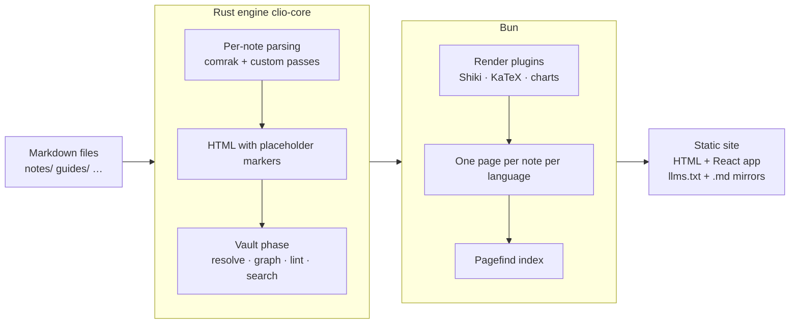
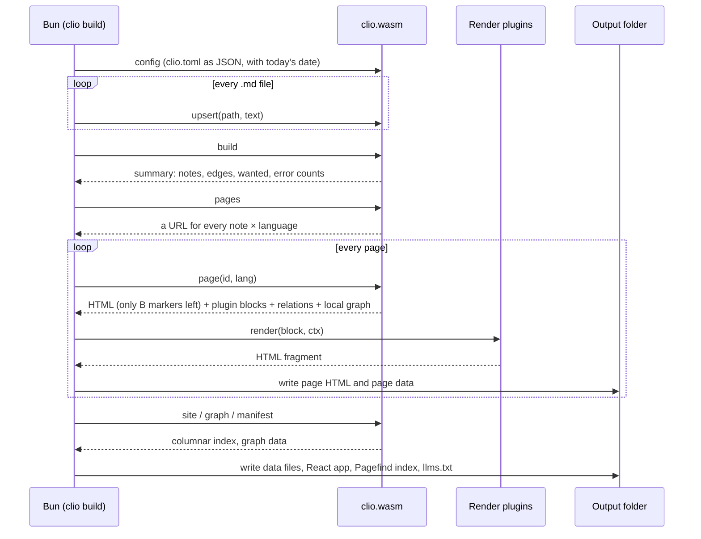

# Architecture

Clio turns a folder of Markdown files into a static website and a set of data for agents. This page follows the data through each part and explains the key design decisions. The input is a folder as described in [[depends-on::vault-layout]]; the syntax is in [[syntax-cheatsheet]].

## Pipeline



| Stage | Where | Input | Output |
|---|---|---|---|
| Per-note parsing | Rust, `crates/clio-core/src/note.rs` | The text of one file | HTML with markers, links, headings, blocks, tags, queries, diagnostics |
| Vault phase | Rust, `crates/clio-core/src/vault.rs` | All parsed notes and the config | Nodes, edges, backlinks, PageRank, clusters, lint results, search index |
| Page generation | Bun, `packages/clio` | JSON from the engine | Static HTML, data files, Pagefind index |
| Browsing | Browser, `packages/web` | The static files | Search, explore, graph and health views |

## Per-note parsing

Each note is parsed on its own, without looking at any other note. The parser is comrak 0.56 with GFM and the extensions turned on (tables, task lists, footnotes, description lists, highlight, wikilinks, math, block directives and more). Once comrak has built the syntax tree, the engine runs a fixed sequence of custom passes:

1. Links: `[[ ]]` and plain links to `.md` files, recording target, section, block, relation name and the sentence around the link;
2. Embeds: `![[ ]]` paragraphs;
3. Block ids: `^id` at the end of a paragraph or list item;
4. Tags: `#tag` in text;
5. Callouts and directives: `> [!note]`, `:::tabs` and so on;
6. Code, math, Mermaid, charts and queries: replaced by placeholders, with the source kept alongside.

Raw HTML is dropped at this stage. Notes may come from web pages ingested by agents, and since the renderer never passes HTML through, no script can be injected into the site.

## Markers

When a note is rendered, the other notes are not known yet and no plugin has run. So anything that depends on another note or on a plugin is first written as a marker:

```text
U+E000  kind  index  U+E001
```

`U+E000` and `U+E001` are two characters from the Unicode private-use area. The kind is one letter, and the index points into one of the note's lists:

| Kind | Meaning | Filled in by |
|---|---|---|
| `L` | Opening tag of a link, `<a …>` | Vault phase: URL, type and wanted state once the target is resolved |
| `t` | Link text for `[[id]]` written without text | Vault phase: the target's title in the page language |
| `E` | Embed | Vault phase: the matching section or block of the target |
| `Q` | Query block | Vault phase: the query result |
| `B` | Plugin block: code, math, Mermaid, chart | Bun: the plugin's HTML |
| `H` | Start of a heading | Used to cut sections for embeds; removed from the output |

Before parsing, the input text has both characters replaced by `U+FFFD`, so a marker can only come from the engine; user content cannot forge one.

What this buys: each note is parsed once, and the result can be cached. When one note changes, only that note is parsed again before the vault phase is redone, which is far cheaper than re-parsing every file. Incremental rebuilds in `clio dev` rely on this.

## Vault phase

Once every note is parsed, the engine works on the whole vault in a fixed order:

1. Group files by id into nodes, one version per language; a repeated id in the same language gives `duplicate-id`;
2. Resolve every link: id → alias → title → path; unresolved targets become ghost nodes; check that sections and blocks exist;
3. Build edges: plain links, typed relations and embeds, each with the sentence that contains it;
4. Compute PageRank and Louvain clusters over the real notes; see [[knowledge-graph]];
5. Vault-level lint: orphans, staleness, missing translations, required fields, `part-of` cycles, query syntax; see [[lint-codes]];
6. Build the BM25 full-text index, splitting Chinese into single characters and adjacent pairs and other text into words.

The read commands (`page`, `site`, `graph`, `search`, `context`, `lint`) all answer from this result without touching the source files again.

## The Bun side

Bun does everything that involves the file system, the network or plugins; the engine itself reads no files and no clock:

- lists the `.md` files in the vault (filtered by `[build] ignore`) and hands their text to the engine;
- for each page, passes the `B` markers to render plugins: Shiki for code (a light and a dark variant), KaTeX for math, the chart plugin for SVG charts, with user plugins from `clio.config.ts` first; see [[config#Plugins]];
- writes one static HTML page per note per language, readable without JavaScript;
- copies the prebuilt React app;
- indexes the whole site with Pagefind (static search written in Rust, with Chinese segmentation);
- writes `llms.txt` and a `.md` mirror of every note for agents that read the site.



## WebAssembly and native builds

The same `clio-core` is compiled two ways:

| Form | Crate | Interface | Used for |
|---|---|---|---|
| WebAssembly, `clio.wasm`, about 1.5 MB | `clio-wasm` | Four `extern "C"` functions: `clio_alloc`, `clio_free`, `clio_command`, `clio_upsert` | Loaded by Bun; users and Vercel need no Rust |
| Native binary | `clio-native` | Reads one JSON command per line from stdin, writes one JSON reply per line to stdout | Tests and benchmarks |

The interface is deliberately narrow: strings move in and out of linear memory as (pointer, length) pairs, and commands and replies are JSON. `clio_upsert` exists separately so that note text does not have to be JSON-escaped. There is no binding generator such as wasm-bindgen, so the loader on the Bun side is short and tied to no binding version.

A test sends the same command sequence (parse the syntax samples, load a test vault, `build`, `lint`, `graph`, `site`, `search`, and `page` and `context` for each note) to both the WebAssembly module and the native binary and compares the replies line by line; they must be byte-identical. That guarantees that results measured with the native build are exactly what users get from WebAssembly.

Checking 5,000 notes takes under 3 seconds; methods and more numbers are in [[performance]].

## Determinism

The same input always produces byte-identical output:

- all maps are `BTreeMap`s and `BTreeSet`s, so iteration order follows the keys and no hash seed is involved;
- files are processed sorted by path;
- PageRank runs exactly 40 iterations with a fixed summation order; Louvain visits nodes by index and breaks ties towards the smaller index;
- the engine never reads the clock. "Today" is passed in by Bun (and can be pinned with the `CLIO_TODAY` environment variable); only the `stale` check depends on it.

Why: the site output can be committed and diffed; two identical builds prove that nothing changed; and the byte-for-byte comparison between WebAssembly and native only means something when the output is deterministic.

## Data files

The React app does not load the whole vault at once; it fetches data as needed:

| Data | Engine command | Contents | Loaded |
|---|---|---|---|
| Page data | `page` | One note's relations, backlinks, outline, local graph and translations | When the note is opened |
| Site index | `site` | Id, title, type, tags, status, summary, rank and cluster of every note, stored as columns | On the home and explore pages |
| Graph data | `graph` | Nodes, edges, edge kinds, clusters | When the graph view is opened |
| Search index | Pagefind | A sharded inverted index | While typing a query, only the shards it needs |

The site index is stored by column (one array per field rather than one object per note), so repeated key names appear once and the index stays small enough to download in one request even for tens of thousands of notes. This is one reason the site scales; see [[information-architecture#Web interface]].

## Why a static site

Clio's site has no server side:

- **Simple to deploy.** The output is a folder. GitHub Pages, Vercel, any object store or `python -m http.server` will serve it; see [[deploy]].
- **Nothing to run or maintain.** No database, no accounts, no processes, and so no service to patch.
- **Readable offline.** Every page is complete HTML, readable without JavaScript, so search engines and agents can fetch it directly.
- **Agents have their own entry points.** `llms.txt` lists every page and each note has a `.md` mirror; locally, agents use the CLI and MCP; see [[agents]].

The cost is that a change needs a rebuild. Locally, `clio dev` re-parses only the changed files and redoes the vault phase; online, CI builds after every push.

## Code map

| Path | Contents |
|---|---|
| `crates/clio-core/src/note.rs` | Per-note parsing and all custom passes |
| `crates/clio-core/src/markers.rs` | Marker format, replacement and forgery protection |
| `crates/clio-core/src/vault.rs` | Vault phase: link resolution, edges, lint, page data |
| `crates/clio-core/src/graph.rs` | PageRank and Louvain |
| `crates/clio-core/src/search.rs` | BM25 index and tokenizer |
| `crates/clio-core/src/query.rs` | Parsing and evaluating `clio-query` |
| `crates/clio-core/src/api.rs` | The JSON command interface |
| `crates/clio-wasm`, `crates/clio-native` | Entry points of the two builds |
| `packages/clio` | Bun CLI, config loading, engine loader |
| `packages/web` | React web app |
