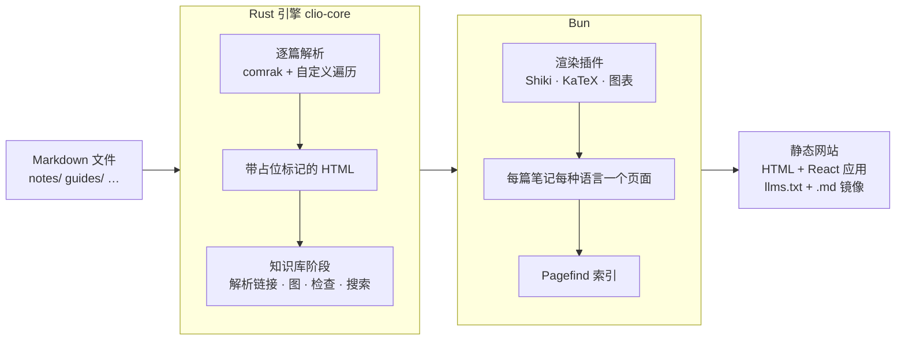
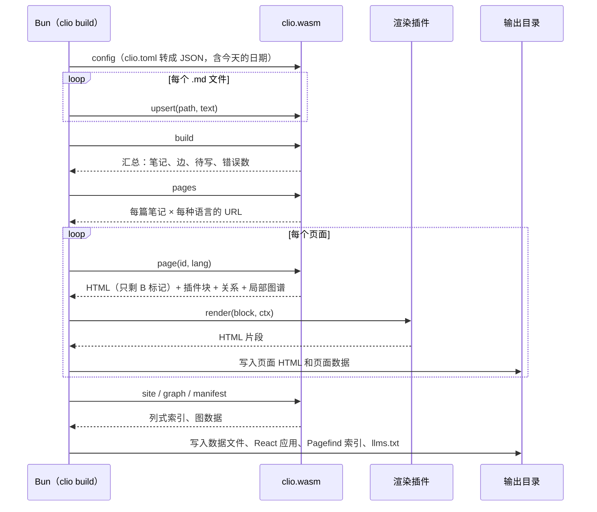

# 架构

Clio 把一个目录里的 Markdown 文件变成一个静态网站和一组给 Agent 用的数据。这一页按数据流向讲每个部分做什么，以及几个关键的设计决定。输入是 [[depends-on::vault-layout]] 中描述的目录，语法见 [[syntax-cheatsheet]]。

## 流水线



| 阶段 | 在哪里 | 输入 | 输出 |
|---|---|---|---|
| 逐篇解析 | Rust，`crates/clio-core/src/note.rs` | 一个文件的文本 | 带标记的 HTML、链接、标题、块、标签、查询、诊断 |
| 知识库阶段 | Rust，`crates/clio-core/src/vault.rs` | 所有已解析的笔记和配置 | 节点、边、反向链接、PageRank、聚类、检查结果、搜索索引 |
| 页面生成 | Bun，`packages/clio` | 引擎返回的 JSON | 静态 HTML、数据文件、Pagefind 索引 |
| 浏览 | 浏览器，`packages/web` | 静态文件 | 搜索、浏览、图谱、健康检查界面 |

## 逐篇解析

每篇笔记单独解析，不看其他笔记。解析器是 comrak 0.56，打开 GFM 和各项扩展（表格、任务列表、脚注、定义列表、高亮、wikilink、数学、块指令等）。comrak 产出语法树之后，引擎按固定顺序跑一组自定义遍历：

1. 链接：`[[ ]]` 和指向 `.md` 的普通链接，记录目标、章节、块、关系名和链接所在的句子；
2. 嵌入：单独成段的 `![[ ]]`；
3. 块 id：段落或列表项末尾的 `^id`；
4. 标签：正文里的 `#tag`；
5. callout 和指令：`> [!note]`、`:::tabs` 等；
6. 代码、公式、Mermaid、图表、查询：换成占位符，原文存到旁边。

原始 HTML 在这一步被丢弃。笔记可能来自 Agent 收录的网页，渲染器不放行任何 HTML，网站上就不会出现脚本注入。

## 占位标记

一篇笔记渲染时，其他笔记还不知道，插件也还没运行。于是凡是依赖其他笔记或依赖插件的内容，引擎都先写一个标记：

```text
U+E000  种类  序号  U+E001
```

`U+E000` 和 `U+E001` 是 Unicode 私用区的两个字符。种类是一个字母，序号指向这篇笔记的某个列表项：

| 种类 | 含义 | 谁来填 |
|---|---|---|
| `L` | 链接的开始标签 `<a …>` | 知识库阶段：解析出目标后写入 URL、类型、是否待写 |
| `t` | `[[id]]` 没写文字时的链接文字 | 知识库阶段：目标的标题（按页面语言） |
| `E` | 嵌入 | 知识库阶段：目标笔记的对应章节或块 |
| `Q` | 查询块 | 知识库阶段：查询结果 |
| `B` | 插件块：代码、公式、Mermaid、图表 | Bun：插件输出的 HTML |
| `H` | 标题的起点 | 切分章节供嵌入使用，输出前删除 |

输入文本在解析之前会把这两个字符替换成 `U+FFFD`，所以标记只可能来自引擎，用户内容无法伪造标记。

这样做的好处：每篇笔记只解析一次，结果可以缓存。改动一篇笔记时，只重新解析这一篇，然后重做知识库阶段，比重新解析所有文件便宜得多。`clio dev` 的增量重建就靠这一点。

## 知识库阶段

所有笔记解析完后，引擎在整个知识库上做以下几步，顺序固定：

1. 按 id 把文件分组成节点，每种语言一个版本；同一语言下 id 重复时报 `duplicate-id`；
2. 解析每个链接：id → 别名 → 标题 → 路径；找不到的变成幽灵节点；检查章节和块是否存在；
3. 生成边：普通链接、类型关系、嵌入，每条边带上链接所在的句子；
4. 在真实笔记之间计算 PageRank 和 Louvain 聚类，见 [[knowledge-graph]]；
5. 知识库级别的检查：孤立笔记、过期、缺翻译、必填字段、`part-of` 环、查询语法，见 [[lint-codes]]；
6. 建立 BM25 全文索引，中文切成单字和相邻两字的组合，英文按单词切分。

之后的读命令（`page`、`site`、`graph`、`search`、`context`、`lint`）都在这份结果上回答，不再碰源文件。

## Bun 这一侧

Bun 负责所有和文件系统、网络、插件有关的事，引擎本身不读文件也不读时钟：

- 列出知识库里的 `.md` 文件（按 `[build] ignore` 过滤），把文本交给引擎；
- 对每个页面，把 `B` 标记交给渲染插件：Shiki 做代码高亮（浅色和深色两套），KaTeX 渲染公式，图表插件画 SVG，用户在 `clio.config.ts` 里注册的插件排在最前，见 [[config#插件]]；
- 每篇笔记每种语言写一个静态 HTML 页面，不运行 JavaScript 也能读；
- 复制预先构建好的 React 应用；
- 用 Pagefind 索引整个网站（Rust 写的静态搜索，支持中文分词）；
- 写出 `llms.txt` 和每篇笔记的 `.md` 原文镜像，给读网站的 Agent 用。



## WebAssembly 与原生构建

同一份 `clio-core` 编译成两种形式：

| 形式 | crate | 接口 | 用途 |
|---|---|---|---|
| WebAssembly，`clio.wasm`，约 1.5 MB | `clio-wasm` | 四个 `extern "C"` 函数：`clio_alloc`、`clio_free`、`clio_command`、`clio_upsert` | Bun 加载它；用户和 Vercel 不需要安装 Rust |
| 原生二进制 | `clio-native` | 从 stdin 每行读一条 JSON 命令，往 stdout 每行写一条 JSON 回复 | 测试、基准测试 |

接口刻意做得很窄：字符串以「指针、长度」的形式进出线性内存，命令和回复都是 JSON。`clio_upsert` 单独存在，是为了传笔记原文时省掉一次 JSON 转义。没有用 wasm-bindgen 之类的绑定生成器，所以 Bun 侧的加载代码很短，也不依赖特定的绑定版本。

测试会把同一串命令（解析语法样例、加载一个测试知识库、`build`、`lint`、`graph`、`site`、`search`、每篇的 `page` 和 `context`）分别发给 WebAssembly 和原生二进制，逐行比较回复，要求字节完全相同。这保证了在 CI 里用原生构建测出的结果，就是用户机器上 WebAssembly 的结果。

5,000 篇笔记的检查在 3 秒内完成，测量方法和更多数字见 [[performance]]。

## 确定性

同样的输入总是产生字节相同的输出：

- 所有映射用 `BTreeMap` 和 `BTreeSet`，遍历顺序由键决定，不受哈希种子影响；
- 文件按路径排序后处理；
- PageRank 固定迭代 40 次，求和顺序固定；Louvain 按节点编号依次处理，平局取编号小的；
- 引擎不读时钟。「今天」由 Bun 传入（可用 `CLIO_TODAY` 环境变量固定），`stale` 检查只依赖这个值。

为什么要这样：网站输出可以放进版本库比较差异；两次构建结果相同，就能确定没有东西变了；WebAssembly 与原生的逐字节比较也只有在输出确定时才有意义。

## 数据文件

React 应用不一次加载整个知识库，而是按需取数据：

| 数据 | 来自引擎命令 | 内容 | 什么时候加载 |
|---|---|---|---|
| 页面数据 | `page` | 一篇笔记的关系、反向链接、大纲、局部图谱、译文列表 | 打开这篇笔记时 |
| 站点索引 | `site` | 所有笔记的 id、标题、类型、标签、状态、摘要、rank、聚类，按列存成数组 | 首页和浏览页 |
| 图数据 | `graph` | 节点、边、边的种类、聚类 | 打开图谱视图时 |
| 搜索索引 | Pagefind | 分片的倒排索引 | 输入搜索词时，只取用到的分片 |

站点索引按列存储（每个字段一个数组，而不是每篇笔记一个对象），重复的键名只出现一次，几万篇笔记的索引也能保持在可以一次下载的大小。这是网站能撑到几万篇笔记的原因之一，见 [[information-architecture#网页界面]]。

## 为什么是静态网站

Clio 的网站没有服务器端：

- **部署简单。** 输出是一个目录，放到 GitHub Pages、Vercel、任何对象存储或 `python -m http.server` 都能用，见 [[deploy]]。
- **没有要运行和维护的东西。** 没有数据库、账号和进程，也就没有需要打补丁的服务。
- **离线可读。** 每个页面是完整的 HTML，不运行 JavaScript 也能读，搜索引擎和 Agent 都能直接抓取。
- **Agent 有专门的入口。** `llms.txt` 列出所有页面，每篇笔记有 `.md` 原文镜像；本地则直接用命令行和 MCP，见 [[agents]]。

代价是改动需要重新构建。`clio dev` 在本地只重新解析改动过的文件，再重做知识库阶段；线上则由 CI 在每次推送后构建。

## 代码地图

| 路径 | 内容 |
|---|---|
| `crates/clio-core/src/note.rs` | 单篇解析和所有自定义遍历 |
| `crates/clio-core/src/markers.rs` | 占位标记的格式、替换和防伪 |
| `crates/clio-core/src/vault.rs` | 知识库阶段：解析链接、边、检查、页面数据 |
| `crates/clio-core/src/graph.rs` | PageRank 和 Louvain |
| `crates/clio-core/src/search.rs` | BM25 索引和分词 |
| `crates/clio-core/src/query.rs` | `clio-query` 的解析和求值 |
| `crates/clio-core/src/api.rs` | JSON 命令接口 |
| `crates/clio-wasm`、`crates/clio-native` | 两种构建的入口 |
| `packages/clio` | Bun 命令行、配置读取、引擎加载 |
| `packages/web` | React 网页应用 |
