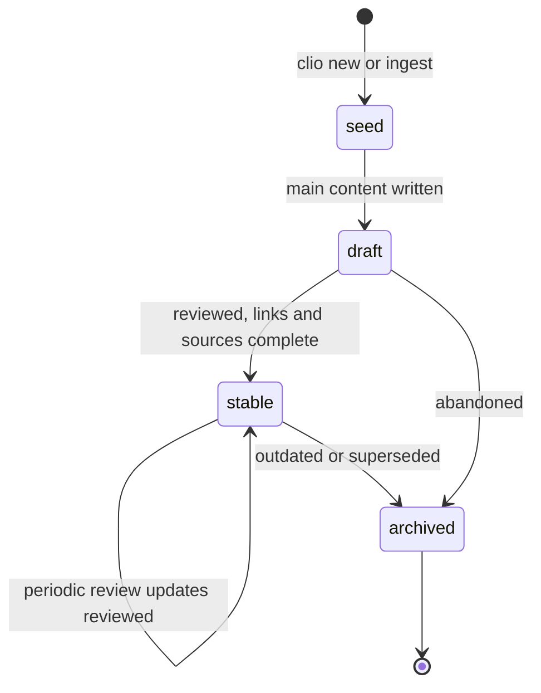
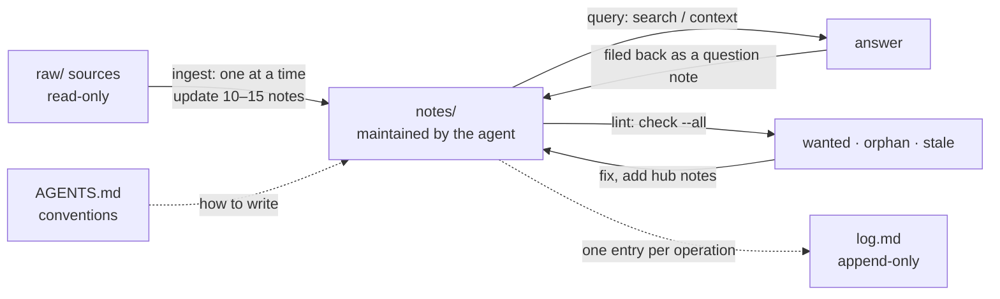

# Information architecture

This page answers one question: how to organise a knowledge base of thousands to tens of thousands of notes so that it can still be maintained. Clio's folder layout, frontmatter fields, lint rules and web interface all follow from the decisions below. The concrete layout is in [[vault-layout]]; how agents work by these rules is in [[agents]].

## Why folder trees break down

A folder tree by topic (`programming/languages/rust/async/`) works well for a few dozen notes. As the vault grows, four problems appear:

- a note usually belongs to several topics, but a folder can hold it only once;
- topic boundaries move — "async" today may split into "runtimes" and "concurrency models" tomorrow — and every change means moving many files;
- if links resolve by path, moving a file breaks them;
- with thousands of notes, nobody finds anything by opening folders level by level.

So Clio does not give folders the job of expressing topics.

## Types over topics

Folders hold a small, stable set of note types. A type says what a note is, not what it is about, so it rarely needs to change:

| Type | Stored in | What one note holds |
|---|---|---|
| `source` | `notes/sources/` | Summary and key points of one raw source, pointing at the original file in `raw/` |
| `concept` | `notes/concepts/` | One concept, method or claim |
| `entity` | `notes/entities/` | One person, organisation, project or product |
| `topic` | `notes/topics/` | Overview and navigation for one topic (a hub note) |
| `question` | `notes/questions/` | The answer to one question, or a comparison of options |
| `journal` | `journal/` | Dated notes |

Topics live elsewhere: in links, hub notes, hierarchical tags and automatic clusters. Ids are global and links resolve by id, so the folder a file sits in never affects its links; see [[linking]].

## Search first

At thousands of notes, people find things by searching and by following links, not by browsing folders. Clio puts search first at every entry point:

- `clio search` on the command line uses BM25, splitting Chinese into single characters and adjacent pairs and other text into words; titles, aliases, tags and headings weigh more than body text;
- the website uses Pagefind, whose index is sharded so that only the parts a query needs are downloaded;
- the first element of the home page is the search box.

How well search works depends on how findable the notes are. Three fields matter most: `title` should use the words readers will search for; `aliases` collects synonyms, abbreviations and the name in the other language; `summary` says in one sentence what the note is about and is shown in search results, lists and link previews.

## Atomic notes and typed relations

One note covers one thing. That way each note can be linked, embedded and reused precisely, and an agent's edit touches only a small piece of content.

Typed relations say how notes are connected: `[[depends-on::id]]`, `[[supports::id]]`, `[[contradicts::id]]`, `[[example-of::id]]` and so on. A relation is declared in one place; the engine computes the inverse and shows it on the target page ("used by ← A, B"), so the two sides can never disagree. These edges form the [[knowledge-graph]].

## Hubs, tags and clusters

Topics are expressed by three mechanisms that complement each other:

| | Hub notes (`topic`) | Hierarchical tags | Automatic clusters |
|---|---|---|---|
| Maintained by | People or agents, by hand | Whoever writes the note | The engine, from the links |
| Expresses | The structure of a topic: what to read first, how it divides, where the disagreements are | Which categories a note belongs to | Which notes are actually closely connected |
| Form | An ordinary note linking to its members, whose `part-of` points back | `#rust/async`; filtering by `rust` includes it | Louvain communities, named after their most common tag or most central note |
| Good for | Entry points and reading guides | Filtering and counting | Finding topics nobody has organised yet |

In practice: when the clusters show a tightly connected group of notes that no hub note points to, it is time to write one. The home page and `clio stats` both list the clusters.

## Catalogs from queries

Hand-written lists go stale: a note is added and nobody updates the list. Clio generates catalogs at build time with `clio-query` blocks:

````markdown
```clio-query
type = concept AND tag = parser AND NOT status = archived
SORT updated DESC
SHOW table
FIELDS summary, updated
```
````

The default project's `index.md`, hub notes and the home page of this handbook all work this way. Hand-written text is kept for what needs judgement: reading order, grouping, recommendations. The query syntax is in [[queries]].

## Lifecycle

Notes have a status, and it changes as they are maintained:



| Status | Meaning |
|---|---|
| `seed` | A title and a few sentences, often created from a wanted note |
| `draft` | Mostly written, not yet checked |
| `stable` | Checked; safe to cite |
| `archived` | No longer maintained; kept for reference |

`reviewed` records the date of the last review. Lint finds the notes that need attention: `stale` (not reviewed within `stale_days`), `orphan` (nothing links here) and `wanted` (linked but not written). Every code is listed in [[lint-codes]].

## Provenance

Every claim in the vault should be traceable to a raw source:

- raw sources live in `raw/` and are read-only. `clio ingest` records each file's sha256, and `clio check` reports a `raw-modified` error if the file changes;
- every raw source has a source note (type `source`) with `raw:` and `sha256:` in its frontmatter;
- claims point to their sources with `[[source::source-note]]`, or with a block reference `[[source-note^block-id]]` when the exact paragraph matters;
- the source note's page lists "cited by ← …" automatically, showing which claims a source supports.

## The Karpathy loop

In his April 2026 "LLM Wiki" gist, Andrej Karpathy describes a way to have a language model maintain a knowledge base: raw sources are layer one, the wiki the model maintains is layer two, and a schema file with the conventions is layer three. There are only three operations — ingest, query and lint — with `index.md` as the catalog and `log.md` as an append-only log of operations. Clio's default project is generated in exactly this shape, with `AGENTS.md` as the schema file.



Three points matter:

1. Ingest one source at a time and merge its content into the 10–15 related notes that already exist, rather than only adding a summary note. The value of the vault comes from this merging.
2. After answering a question, file a useful answer back as a `question` note so it never has to be worked out again.
3. Lint periodically and treat wanted, orphaned and stale notes as the to-do list.

## Web interface

The web interface is ordered search → hubs → clusters → faceted list → graph: the earlier steps suit targeted lookups, the later ones suit wandering.

| Page | Contents | Why |
|---|---|---|
| Home | Search box; hub notes; automatic clusters with their most central notes; recent changes | People with a target search directly; everyone else enters through hubs and clusters |
| Explore | All notes as a list, with facets and sorting by type, tag, status, language, folder and update date | Answers "which notes are there…" from the site index alone, without a server |
| Note page | Body; outline; typed relations and plain backlinks (with the linking sentence); local graph; translations | The next step after reading a note is right beside it |
| Graph | The global graph, with nodes coloured and shaped by type, filterable by cluster and type | Shows the overall structure, islands and bridges |
| Tags | All tags with counts, expandable by hierarchy | The whole tag picture |
| Health | Lint results, wanted notes, missing and stale translations | The to-do list for maintainers and agents |

With tens of thousands of notes, the interface never loads everything at once: the site index is stored by column, each note's relations and local graph are fetched when it is opened, and search loads index shards on demand. How the data is split is in [[architecture#Data files]]; measurements are in [[performance]].

## A checklist

The decisions above, as day-to-day practice:

- [ ] Put a new note in its type's folder; do not create topic subfolders.
- [ ] Give every note a `summary`, and `aliases` where useful.
- [ ] Link every new note from at least one hub note, or point its `part-of` at one.
- [ ] Use a typed relation whenever you can say what the relation is.
- [ ] Link claims to source notes.
- [ ] Generate catalog lists with queries.
- [ ] Add a `log.md` entry for every ingest, answer and lint pass.
- [ ] Run `clio check --all` regularly and work through `wanted`, `orphan` and `stale`.
