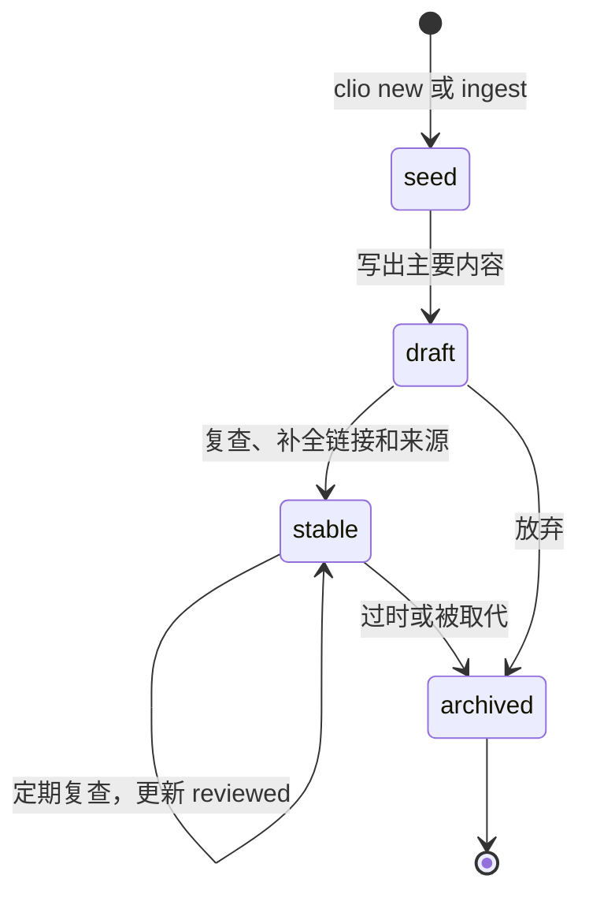
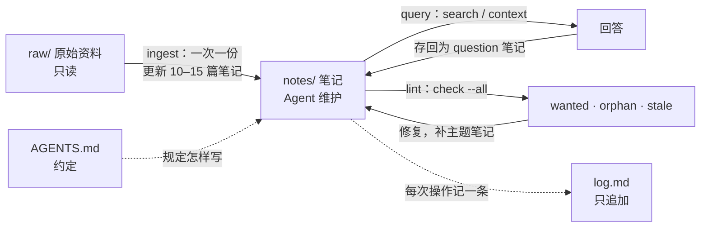

# 信息架构

这一页回答一个问题：几千到几万篇笔记的知识库，怎样组织才能一直维护得动。Clio 的目录结构、frontmatter 字段、检查规则和网页界面都来自下面这些决定。具体的目录布局见 [[vault-layout]]，Agent 怎样按这些规则工作见 [[agents]]。

## 目录树为什么撑不住

按主题建目录树（`编程/语言/Rust/异步/`）在几十篇笔记时很好用，规模变大后会出现四个问题：

- 一篇笔记往往属于好几个主题，目录只能选一个；
- 主题的边界会变，今天的「异步」明天可能拆成「运行时」和「并发模型」，每次调整都要移动大量文件；
- 如果链接按路径解析，移动文件就会断链；
- 几千篇笔记时没人会逐层点开目录找东西。

所以 Clio 不让目录承担「主题」这个职责。

## 类型优先于主题

目录只放一小组稳定的笔记类型。类型描述笔记是什么，而不是笔记讲什么，因此很少需要改：

| 类型 | 存放 | 一篇笔记写什么 |
|---|---|---|
| `source` 来源 | `notes/sources/` | 一份原始资料的摘要和要点，指向 `raw/` 里的原文件 |
| `concept` 概念 | `notes/concepts/` | 一个概念、方法或结论 |
| `entity` 实体 | `notes/entities/` | 一个人、组织、项目或产品 |
| `topic` 主题 | `notes/topics/` | 一个主题的概览和导航（主题笔记） |
| `question` 问答 | `notes/questions/` | 一个问题的回答，或几种方案的比较 |
| `journal` 日志 | `journal/` | 按日期记的笔记 |

主题放在别处：链接、主题笔记、层级标签和自动聚类。id 是全局的，链接按 id 解析，所以文件放在哪个目录都不影响链接，见 [[linking]]。

## 搜索优先

到了几千篇笔记，人找东西靠搜索和顺着链接走，不靠浏览目录。Clio 在每个入口都把搜索放在第一位：

- 命令行的 `clio search` 用 BM25，中文切成单字和相邻两字的组合，英文按单词切分；标题、别名、标签和章节标题的权重高于正文；
- 网站用 Pagefind，索引分片存放，只下载用到的部分；
- 网站首页的第一个元素是搜索框。

搜索好不好用，取决于笔记写得好不好找。三个字段对此影响最大：`title` 用读者会搜的词；`aliases` 收录同义词、缩写和另一种语言的叫法；`summary` 一句话说清这篇讲什么，它显示在搜索结果、列表和链接预览里。

## 原子笔记和类型关系

一篇笔记只讲一件事。这样每篇都能被准确地链接、嵌入和复用，Agent 改动时也只影响一小块内容。

笔记之间用类型关系说明是什么联系：`[[depends-on::id]]`、`[[supports::id]]`、`[[contradicts::id]]`、`[[example-of::id]]` 等。关系只在一处声明，反向关系由引擎计算，显示在目标页面上（「被依赖 ← A, B」），不会出现两边不一致。这些边构成 [[knowledge-graph]]。

## 主题笔记、标签和聚类

主题由三种机制共同表达，它们互相补充：

| | 主题笔记（`topic`） | 层级标签 | 自动聚类 |
|---|---|---|---|
| 由谁维护 | 人或 Agent 手写 | 写笔记时标注 | 引擎根据链接计算 |
| 表达什么 | 一个主题的结构：先读什么、分几块、有哪些争议 | 一篇笔记属于哪些类别 | 哪些笔记实际上联系紧密 |
| 形式 | 一篇普通笔记，链接到成员，成员用 `part-of` 指回来 | `#rust/async`，按 `rust` 筛选时也包含它 | Louvain 社区，用最常见的标签或最重要的笔记命名 |
| 适合 | 入口和导读 | 筛选和统计 | 发现没人整理过的主题 |

实践上：自动聚类发现某一片笔记联系很紧，但没有主题笔记指向它们时，就该写一篇主题笔记了。网站首页和 `clio stats` 都列出聚类。

## 用查询生成目录

手写的目录列表会过期：新建了笔记，没人去更新列表。Clio 的目录用 `clio-query` 代码块在构建时生成：

````markdown
```clio-query
type = concept AND tag = parser AND NOT status = archived
SORT updated DESC
SHOW table
FIELDS summary, updated
```
````

默认项目的 `index.md`、主题笔记和这本手册的首页都这样做。手写的部分只留给需要判断的内容：阅读顺序、分组说明、推荐。查询语法见 [[queries]]。

## 生命周期

笔记有状态，状态随维护而变化：



| 状态 | 含义 |
|---|---|
| `seed` | 只有标题和几句话，常常是从「待写笔记」建出来的 |
| `draft` | 内容基本写完，还没核对 |
| `stable` | 核对过，可以引用 |
| `archived` | 不再维护，保留供参考 |

`reviewed` 记录最后一次复查的日期。检查规则负责找出需要处理的笔记：`stale`（超过 `stale_days` 没复查）、`orphan`（没人链接）、`wanted`（被链接但还没写）。每个检查码见 [[lint-codes]]。

## 出处

知识库里的结论要能追溯到原始资料：

- 原始资料放在 `raw/`，只读。`clio ingest` 记录每个文件的 sha256，文件被改动时 `clio check` 报 `raw-modified` 错误；
- 每份原始资料有一篇来源笔记（`source` 类型），frontmatter 里有 `raw:` 和 `sha256:`；
- 结论用 `[[source::来源笔记]]` 指向来源，需要精确到段落时用块引用 `[[来源笔记^块id]]`；
- 来源笔记页面上自动列出「被引用 ← …」，能看到一份资料支撑了哪些结论。

## Karpathy 循环

Andrej Karpathy 在 2026 年 4 月的「LLM Wiki」gist 里描述了一种让语言模型维护知识库的方式：原始资料是第一层，由模型维护的 wiki 是第二层，规定约定的 schema 文件是第三层；对知识库的操作只有三种：收录（ingest）、查询（query）、检查（lint）；`index.md` 是目录，`log.md` 是只追加的操作日志。Clio 的默认项目就按这个结构生成，`AGENTS.md` 是 schema 文件。



三个要点：

1. 一次只收录一份资料，并把它的内容合并进已有的 10–15 篇相关笔记，而不是只新建一篇摘要。知识库的价值在于这种合并。
2. 回答问题之后，把有价值的回答作为 `question` 笔记存回知识库，下次不用重新推导。
3. 定期跑检查，把待写笔记、孤立笔记和过期笔记当作待办清单处理。

## 网页界面

网页界面按「搜索 → 主题笔记 → 聚类 → 分面列表 → 图谱」的顺序组织，越往后越适合漫游，越往前越适合目标明确的查找。

| 页面 | 内容 | 为什么这样设计 |
|---|---|---|
| 首页 | 搜索框；主题笔记；自动聚类及其最重要的几篇；最近更新 | 目标明确的人直接搜索，其余的人从主题和聚类进入 |
| 浏览 | 所有笔记的列表，按类型、标签、状态、语言、目录、更新时间分面筛选和排序 | 回答「有哪些……」这类问题，只用站点索引，不需要服务器 |
| 笔记页 | 正文；大纲；类型关系和普通反向链接（带链接所在的句子）；局部图谱；译文切换 | 读完一篇后的下一步就在旁边 |
| 图谱 | 全局图谱，节点按类型着色并区分形状，可按聚类和类型过滤 | 看整体结构，发现孤岛和桥梁 |
| 标签 | 所有标签及数量，层级展开 | 标签的全貌 |
| 健康 | 检查结果、待写笔记、缺失和过期的翻译 | 维护者和 Agent 的待办清单 |

几万篇笔记时，界面不一次加载全部内容：站点索引按列存储，每篇笔记的关系和局部图谱在打开时才获取，搜索索引按需加载分片。数据文件的划分见 [[architecture#数据文件]]，具体数字见 [[performance]]。

## 一份清单

把上面的决定落到日常操作上：

- [ ] 新笔记放进对应类型的目录，不按主题建子目录；
- [ ] 每篇笔记写 `summary`，必要时写 `aliases`；
- [ ] 每篇新笔记至少链接到一篇主题笔记，或用 `part-of` 指向它；
- [ ] 能说清关系时用类型关系，而不是普通链接；
- [ ] 结论链接到来源笔记；
- [ ] 目录列表用查询生成；
- [ ] 每次收录、回答、检查都记一条 `log.md`；
- [ ] 定期 `clio check --all`，处理 `wanted`、`orphan` 和 `stale`。
