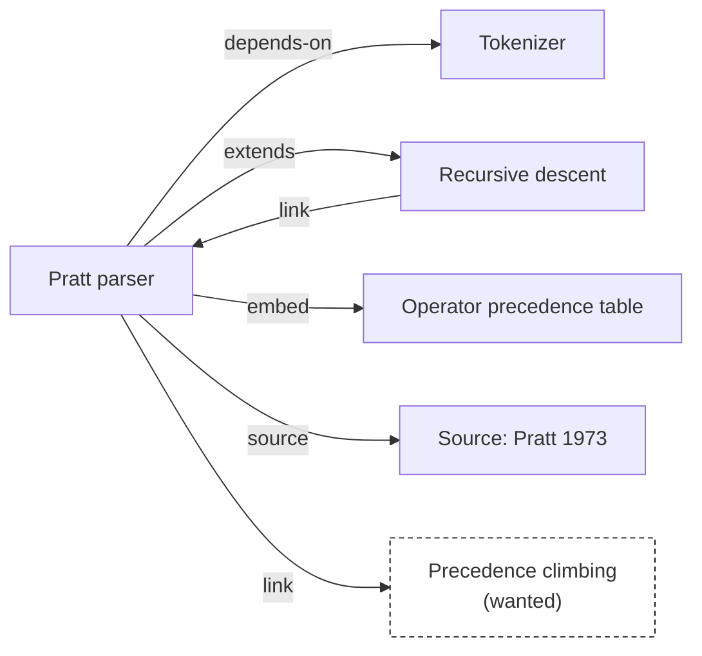

# Knowledge graph

Clio treats the whole vault as a graph: notes are nodes, links are edges. The graph drives backlinks, the relation lists on each page, clusters, importance ranking and the graph view. This page [[extends::linking]]: that page covers how to write links, this one covers what the engine computes from them.

## Nodes

Every id is one node. The language versions of a note (`pratt-parser.md`, `pratt-parser.en.md`) are two versions of one node, not two nodes. Chinese and English pages therefore see the same graph, with the same backlinks and clusters.

Each node has a primary version: the file in the earliest language of `locales` that exists, normally the default language. Edges are taken from the primary version only. Links in translations are rendered and checked as usual but add no edges, so a translation should link to the same notes as its source.

Besides real notes the graph also has ghost nodes; see [[#Ghost nodes]].

## Edges

An edge points from the note that contains a link to the note it links to. There are three kinds:

| Kind | Written as | Edge `kind` |
|---|---|---|
| Plain link | `[[id]]`, `[[id\|text]]`, `[[id#section]]`, `[text](x.md)` | `link` |
| Typed relation | `[[depends-on::id]]` in the body, or `rel: { depends-on: id }` in frontmatter | the relation name, e.g. `depends-on` |
| Embed | `![[id]]` or `![[id#section]]` as its own paragraph | `embed` |

Between the same pair of notes, edges of the same kind are recorded once: linking `[[tokenizer]]` five times in a note still gives one `link` edge. Different kinds are kept apart: writing both `[[tokenizer]]` and `[[depends-on::tokenizer]]` gives two edges. Each edge keeps the sentence that contains the link, and that sentence is what backlink lists show.

A link from a note to itself is not an edge.

## Inverse labels

A relation is declared in one place; the engine derives the other end. Every relation has a forward and an inverse name and label: the source page shows the forward label, the target page the inverse one.

| Relation | Inverse (shown on the target) | Chinese labels | English labels |
|---|---|---|---|
| `depends-on` | `used-by` | 依赖 / 被依赖 | depends on / used by |
| `part-of` | `has-part` | 属于 / 包含 | part of / has part |
| `supports` | `supported-by` | 支持 / 被支持 | supports / supported by |
| `source` | `cited-by` | 来源 / 被引用 | source / cited by |
| `extends` | `extended-by` | 扩展 / 被扩展 | extends / extended by |
| `example-of` | `has-example` | 示例 / 有示例 | example of / has example |
| `contradicts` | (symmetric) | 矛盾 | contradicts |
| `see-also` | (symmetric) | 参见 | see also |

Symmetric relations use the same label at both ends. Inverse names may be written directly: `[[used-by::A]]` in B has the same effect as `[[depends-on::B]]` in A. `clio.toml` can add relations; see [[config#relations]].

Why: if backlinks were stored on both sides, sooner or later the two copies would disagree. Storing a relation once and computing the other side on every build makes that impossible.

On a page, typed relations are grouped by label ("depends on → Tokenizer", "used by ← Expression engine"); plain links and embeds are listed under "linked from", each with the sentence that contains it.

## Ghost nodes

When a link's target does not exist, Clio does not drop it as an error. It creates a ghost node, also called a wanted note:

- the link renders as usual and points to the site's "wanted" page, which lists every wanted note and where it is linked from;
- the graph view draws it as a hollow, dashed node;
- `clio check` reports a `wanted` warning, and `clio context` lists it under "Wanted" at the end;
- several notes linking to the same missing name share one ghost node.

The more a wanted note is linked, the sooner it is worth writing. For an agent this list is a to-do list. Ghost nodes take no part in PageRank or clustering.

## PageRank

PageRank measures how central a note is: a note scores high when many notes link to it, or when central notes do. Clio computes it over real notes only, ignoring edge kinds and counting several edges between the same pair once:

$$
PR(v) = \frac{1-d}{N} + d \left( \sum_{u \to v} \frac{PR(u)}{L(u)} + \sum_{w \in D} \frac{PR(w)}{N} \right)
$$

- $N$ is the number of notes and $d = 0.85$ the damping factor;
- $u \to v$ ranges over the notes that link to $v$, and $L(u)$ is the number of distinct notes $u$ links to;
- $D$ is the set of notes with no outgoing edges; their score is spread evenly over all notes, so the total is always 1;
- every score starts at $1/N$, and there are exactly 40 iterations. A fixed count rather than a convergence threshold keeps the result bit-identical on every machine.

Uses: cluster members are ordered by PageRank, and a cluster without a suitable tag is named after its top note; the home and explore pages can sort by it; and it is the `rank` field of `clio show --json`.

## Louvain communities

Clustering puts closely connected notes into groups, which helps find topics nobody has organised. Clio uses the Louvain algorithm, which maximises modularity:

$$
Q = \frac{1}{2m} \sum_{i,j} \left[ A_{ij} - \frac{k_i k_j}{2m} \right] \delta(c_i, c_j)
$$

$A_{ij}$ is the edge weight between notes $i$ and $j$, $k_i$ the total edge weight of $i$, $m$ the total edge weight, and $\delta(c_i, c_j)$ is 1 when both notes are in the same group. Put simply, $Q$ grows as groups contain more edges than random wiring would predict.

The computation uses an undirected weighted graph: every edge between two notes (one per `kind`, in either direction) adds 1 to their weight. The algorithm alternates two steps:

1. Local moves: visit the nodes in index order and move each one to the neighbouring group that increases modularity the most; on a tie, the group with the smaller index wins. Repeat for up to 32 rounds, until no node moves.
2. Aggregation: collapse each group into a single node, summing the edge weights between groups, and go back to step 1.

It stops when no node moves. Groups are numbered by size, largest first, with ties ordered by their smallest member. No random numbers are involved, so the result is deterministic.

### Naming clusters

Each cluster needs a name a person can read:

1. Count the tags of all notes in the group and take the most frequent tag shared by at least two notes, shown as `#tag`; on a tie, the alphabetically first one wins.
2. If there is no such tag, use the title of the note with the highest PageRank in the group.

So consistent tagging gives readable cluster names. `clio stats` lists every cluster with its size.

## Graph view

The site's graph view draws all nodes and edges with a force-directed layout:

- **Type is encoded twice, by colour and by shape**: each note type has its own candy colour and its own node shape, so readers with colour-vision deficiencies can still tell types apart; see [[design]];
- the larger a node, the higher its PageRank;
- ghost nodes are drawn hollow and dashed;
- the view can be filtered by type and cluster, and clicking a node opens the note.

### Local graph

Every note page has a local graph: the note, every directly connected note (in both directions, ghost nodes included) and the edges that touch the note. It is loaded with the page data and does not need the global graph. While you read a note, it shows what lies around it.
