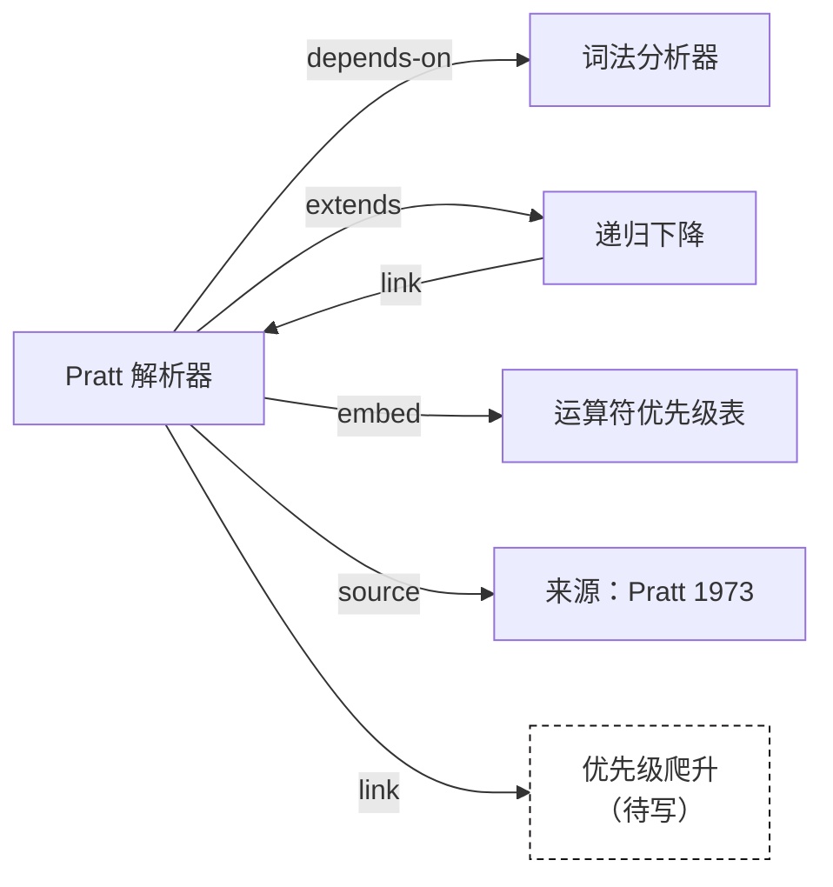

# 知识图谱

Clio 把整个知识库当作一张图：笔记是节点，链接是边。这张图决定了反向链接、页面上的关系列表、聚类、重要度排序和图谱视图。这一页 [[extends::linking]]：那一页讲怎样写链接，这一页讲链接写下之后引擎用它们算出什么。

## 节点

每个 id 是一个节点。同一篇笔记的不同语言版本（`pratt-parser.md`、`pratt-parser.en.md`）是同一个节点的两个版本，不是两个节点。所以中英文页面看到的是同一张图，反向链接和聚类也相同。

每个节点有一个主版本：`locales` 中排在最前、且存在的那种语言的文件，通常就是默认语言的文件。图的边只取自主版本。译文里的链接照常渲染和检查，但不另外加边；译文应当与原文链接到同样的笔记。

除了真实笔记，图里还有幽灵节点，见 [[#幽灵节点]]。

## 边

一条边从写链接的笔记指向被链接的笔记，有三种来源：

| 种类 | 写法 | 边的 `kind` |
|---|---|---|
| 普通链接 | `[[id]]`、`[[id\|文字]]`、`[[id#章节]]`、`[文字](x.md)` | `link` |
| 类型关系 | 正文 `[[depends-on::id]]`，或 frontmatter `rel: { depends-on: id }` | 关系名，如 `depends-on` |
| 嵌入 | 单独成段的 `![[id]]`、`![[id#章节]]` | `embed` |

同一对笔记之间、同一种类的边只记一条：一篇笔记里链接 `[[tokenizer]]` 五次，仍然是一条 `link` 边。不同种类分开记：同时写了 `[[tokenizer]]` 和 `[[depends-on::tokenizer]]`，就有两条边。每条边保存链接所在的那句话，反向链接列表显示的就是这句话。

指向自己的链接不算边。

## 反向标签

关系只在一处声明，另一端由引擎推出。每种关系有正向和反向两个名字和标签：源页面显示正向标签，目标页面显示反向标签。

| 关系 | 反向（显示在目标上） | 中文标签 | 英文标签 |
|---|---|---|---|
| `depends-on` | `used-by` | 依赖 / 被依赖 | depends on / used by |
| `part-of` | `has-part` | 属于 / 包含 | part of / has part |
| `supports` | `supported-by` | 支持 / 被支持 | supports / supported by |
| `source` | `cited-by` | 来源 / 被引用 | source / cited by |
| `extends` | `extended-by` | 扩展 / 被扩展 | extends / extended by |
| `example-of` | `has-example` | 示例 / 有示例 | example of / has example |
| `contradicts` | （对称） | 矛盾 | contradicts |
| `see-also` | （对称） | 参见 | see also |

对称关系两端用同一个标签。可以写反向名：在 B 里写 `[[used-by::A]]` 与在 A 里写 `[[depends-on::B]]` 效果相同。`clio.toml` 可以添加新关系，见 [[config#relations]]。

这样设计的原因：反向链接如果在两边各存一份，迟早会不一致；只存一份，另一边每次构建时计算，就不会出错。

页面上，类型关系按标签分组显示（「依赖 → 词法分析器」「被依赖 ← 表达式引擎」）；普通链接和嵌入列在「链接到这里」下，带链接所在的句子。

## 幽灵节点

链接的目标找不到时，Clio 不把它当错误丢掉，而是建一个幽灵节点，也叫待写笔记：

- 链接照常渲染，指向网站上的「待写」页面，那里列出所有待写笔记和链接到它们的地方；
- 图谱视图里画成空心的虚线节点；
- `clio check` 报 `wanted` 警告，`clio context` 在末尾列出「Wanted」；
- 几篇笔记链接同一个不存在的名字时，它们共用一个幽灵节点。

被链接得越多的待写笔记越值得先写。对 Agent 来说，这份列表就是待办清单。幽灵节点不参与 PageRank 和聚类。

## PageRank

PageRank 衡量一篇笔记有多「核心」：被很多笔记链接，或被核心笔记链接的笔记得分高。Clio 在真实笔记之间计算，忽略边的种类，同一对笔记之间的多条边只算一次：

$$
PR(v) = \frac{1-d}{N} + d \left( \sum_{u \to v} \frac{PR(u)}{L(u)} + \sum_{w \in D} \frac{PR(w)}{N} \right)
$$

- $N$ 是笔记数，$d = 0.85$ 是阻尼系数；
- $u \to v$ 遍历所有链接到 $v$ 的笔记，$L(u)$ 是 $u$ 链接到的不同笔记数；
- $D$ 是没有任何出边的笔记，它们的得分平均分给所有笔记，所以总分始终为 1；
- 初值都是 $1/N$，固定迭代 40 次。迭代次数固定而不是按收敛阈值停止，是为了让结果在任何机器上逐位相同。

用途：聚类成员按 PageRank 排序，聚类在没有合适标签时用排第一的笔记命名；首页和浏览页可以按它排序；它也写在 `clio show --json` 的 `rank` 字段里。

## Louvain 社区

聚类把联系紧密的笔记分到一组，用来发现没有人整理过的主题。Clio 用 Louvain 算法最大化模块度：

$$
Q = \frac{1}{2m} \sum_{i,j} \left[ A_{ij} - \frac{k_i k_j}{2m} \right] \delta(c_i, c_j)
$$

$A_{ij}$ 是笔记 $i$ 和 $j$ 之间的边权，$k_i$ 是 $i$ 的边权之和，$m$ 是总边权，$\delta(c_i, c_j)$ 在两篇笔记属于同一组时为 1。直观地说，组内的边比随机连接时预期的越多，$Q$ 越大。

计算用的是无向带权图：不论方向，两篇笔记之间每条边（每种 `kind` 一条）加 1 权重。算法分两步反复进行：

1. 局部移动：按编号依次处理每个节点，把它移到使模块度增加最多的相邻组；增益相同时选编号小的组。最多 32 轮，直到没有节点移动；
2. 合并：把每个组缩成一个节点，组间的边权相加，回到第 1 步。

没有节点再移动时结束。各组按大小从大到小编号，大小相同时按最小成员编号排序。整个过程没有随机数，结果是确定的。

### 聚类的命名

每个聚类需要一个人能看懂的名字：

1. 统计组内所有笔记的标签，取至少两篇笔记共有的、出现次数最多的标签，显示为 `#标签`；次数相同时取字母序最前的；
2. 没有这样的标签时，用组内 PageRank 最高的笔记的标题。

所以标签打得一致，聚类的名字就好读。`clio stats` 列出所有聚类和大小。

## 图谱视图

网站的图谱视图画出全部节点和边，用力导向布局：

- **类型用颜色和形状两种方式表示**：每种笔记类型有自己的糖果色和节点形状，色觉障碍的读者也能区分类型，见 [[design]]；
- 节点越大，PageRank 越高；
- 幽灵节点画成空心虚线；
- 可以按类型和聚类过滤，点击节点打开那篇笔记。

### 局部图谱

每篇笔记的页面上有一个局部图谱：这篇笔记、所有直接相连的笔记（两个方向都算，包括幽灵节点），以及与这篇笔记相连的边。它和页面数据一起加载，不需要全局图数据。读一篇笔记时，它回答「这篇周围有什么」。
