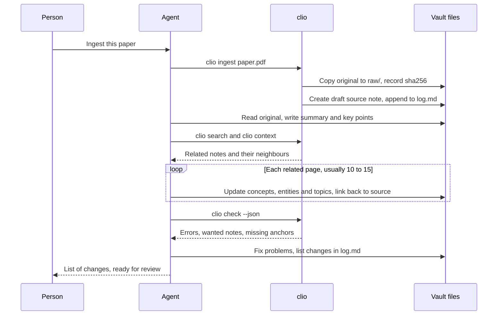

# Working with agents

Clio is designed for a vault that people and AI agents maintain together: people choose sources, ask questions and review changes; agents do the time-consuming part of organising, cross-referencing and checking. This page explains where that division of work comes from, which files and commands support it in Clio, and the steps of each workflow. It [[depends-on::vault-layout]], so the folder structure is worth knowing first.

## The LLM Wiki pattern

In April 2026 Andrej Karpathy published a note called "LLM Wiki" describing how to keep a personal knowledge base with a language model. The main points:

- **Don't rediscover knowledge on every question.** Retrieval-augmented generation (RAG) goes back to the raw documents and re-reads them for every question. In an LLM Wiki the model gradually turns what it reads into a persistent, interlinked Markdown knowledge base, so knowledge accumulates.
- **Three layers.** Raw sources are read-only; the model writes and maintains the wiki; a schema file (such as `CLAUDE.md` or `AGENTS.md`) tells the model how the wiki is structured and what the rules are.
- **Three operations.** Ingest: read a new source and update every page it touches, often ten to fifteen. Query: answer from the wiki and file good answers back as new pages. Lint: periodically look for contradictions, outdated claims, orphan pages and missing cross-references.
- **Two special files.** `index.md` is the catalog; `log.md` records every operation in time order, append-only.

Clio maps each part of the pattern to concrete files and commands:

| Part of the pattern | In Clio |
|---|---|
| Raw sources, read-only | `raw/`; `clio ingest` adds a file and records its sha256; `clio check` reports `raw-modified` if it changes |
| The wiki the model maintains | Notes under `notes/`, stored by type and connected by typed links |
| The schema file | `AGENTS.md` (which `CLAUDE.md` includes), `clio.toml`, `templates/` |
| `index.md` | The home page, whose catalog is generated by query blocks rather than maintained by hand |
| `log.md` | Entries appended by `clio log` and `clio ingest` |
| Ingest, query, lint | Workflows in the Agent Skill, using `clio search`, `clio context`, `clio check` and other commands |
| Searching the wiki | `clio search` (BM25, Chinese and English) and `clio mcp` |

One difference from the original: Karpathy's `index.md` is kept by the model entry by entry, each with a one-line summary. Clio keeps the summary in each note's frontmatter and generates the catalog with queries. The catalog is right whenever notes are added or removed, and the model has one fewer error-prone file to maintain.

## The Agent Skill

`clio new site` and `clio init` install an Agent Skill in the project: `skills/clio/SKILL.md`, in the Agent Skills format. The skill folder is linked as `.claude/skills/clio` and `.agents/skills/clio`, where Claude Code, Codex and other tools find it on their own; where symlinks cannot be created, it is copied instead. It tells the agent:

- when to use the skill: ingesting sources, answering questions about the vault, maintaining or translating notes;
- every step of the four workflows below;
- which `clio` command to use at each step, and how to read its `--json` output;
- what must be true before finishing: `clio check` reports no errors, and `log.md` has been appended to.

The skill describes the generic workflow only. Conventions specific to this vault, such as its custom types or the language of titles, belong in `AGENTS.md`. Tools without skill support can work from `AGENTS.md` alone.

## AGENTS.md is the schema layer

`AGENTS.md` is layer 3: the conventions for agents. Tools such as Codex read `AGENTS.md` directly; `CLAUDE.md` contains a single line, `@AGENTS.md`, so Claude Code reads the same file. The version `clio new site` writes covers layout, writing and logging rules, and you can adapt it, for example:

```markdown title="AGENTS.md (excerpt)"
# Vault conventions

## Layout
- raw/ is read-only. Never edit or delete files in it.
- One source note per source, in notes/sources/, with raw and sha256 in the frontmatter.
- Concepts go in notes/concepts/, people and organisations in notes/entities/, overviews in notes/topics/.

## Writing
- Ids are English kebab-case; titles are in English.
- Every note has a one-sentence summary that states the conclusion, not "This note covers".
- Cite sources with [[source::source-id]] and specific claims with [[source-id^block-id]].
- When a new claim contradicts an old one, add [[contradicts::id]]; never silently overwrite the old claim.

## Log
- After each operation append ## [YYYY-MM-DD] op | title to log.md, followed by the notes changed.

## Checks
- Run clio check --json before finishing; errors must be 0.
```

The more specific the conventions, the more alike the notes written by different agents and sessions. When the conventions need to change, have the agent propose the change and let a person decide.

## Ingest

The full steps for ingesting a new source:

:::steps
### Add the original

```bash
clio ingest ~/Downloads/attention.pdf --title "Attention Is All You Need"
```

The original is copied to `raw/` and its sha256 recorded; a `draft` source note is created under `notes/sources/`; `log.md` gets an `ingest` entry.

### Write the source note

The agent reads the original and writes the summary and key points into the source note. Each key point ends with a block id (`^claim-1`) so that other notes can cite it precisely. The source note records what the original says, without commentary.

### Find related notes

```bash
clio search "attention transformer" --json
clio context transformer --hops 2
```

Search first, then use `clio context` to read the most relevant notes and their neighbours, and decide which pages need updating.

### Update related pages

One source usually touches ten to fifteen pages: update existing concepts and entities, create notes for important new concepts, and add the new material to topic notes. Every new claim links back to its source: `[[source::attention-is-all-you-need]]` or `[[attention-is-all-you-need^claim-1]]`. Where a new claim conflicts with an existing one, mark it with a `contradicts` relation.

### Run the checks

```bash
clio check --json
```

Fix every error, and deal with the `wanted` and `missing-anchor` warnings this ingest introduced: either write the missing note or correct the link.

### Log it and hand over for review

Under this ingest's entry in `log.md`, list the notes created and updated, then hand the change to a person for review, usually as a git diff or a pull request.
:::

One ingest, step by step:



## Query

Answering a question from the vault:

1. `clio search "<keywords from the question>" --json` finds candidate notes; read their summaries first.
2. Run `clio context <id> --hops 2` on the one or two most relevant notes to read them in full with their neighbours.
3. Link the answer to the notes it relies on, so a person can check it.
4. If the answer is worth keeping (a comparison, an analysis), file it with `clio new question "<question>" --id <english-id>` under `notes/questions/`, link it to the notes it relies on, and link to it from the relevant topic notes. Without `--id` the id comes from the title, so a Chinese title gives a Chinese id.
5. Record it with `clio log query "<question>"`, listing the notes created and updated with `--message`.

Step 4 is what makes the pattern work: good answers don't stay in a chat history; they go back into the vault, ready for the next question.

## Lint

Run a full check periodically, say once a week:

```bash
clio check --json --all
```

| Finding | What to do |
|---|---|
| `wanted` | If several notes link to it, write the note; if it was a passing mention, remove the link |
| `orphan` | Link it from the relevant topic note, or decide whether it is still needed |
| `stale` | Reread it against its sources; once it checks out, update `reviewed` |
| `contradicts` relations | Read both sides' sources; state the conclusion where you can, keep both views where you can't |
| `translation-stale` | See the next section |

Linting also covers what the engine can't see: two notes on the same concept, a summary that no longer matches the body, a long note that should be split. Finish with `clio log lint "<summary>"`.

## Translate

1. `clio translate-status --json` lists missing, unpinned and stale translations.
2. Create a missing translation with `clio new <type> "<translated title>" --id <id> --lang en`: it copies the original to `<id>.en.md` for you to translate. Update a stale one to match the changes in the original.
3. `clio translate-status --pin <id>` writes the original's current hash into the translation's `translation-of-hash`. For several notes, separate the ids with commas: `--pin a,b,c`.
4. `clio check` confirms there is no `translation-stale` left.

The hash can also be written into `translation-of-hash` by hand; the value is the hash given in the list. File naming and hashes are explained in [[multilingual]].

## Commands for agents

Every read-only command supports `--json`, with stable field names. All fields are described in [[cli#JSON output]].

### clio context

Puts a note's source and its graph neighbourhood into one Markdown document, ready for a model's context. `--hops 2` adds the neighbours' neighbours.

```text
$ clio context vector-search
# Vector search (vector-search, concept)

path: notes/concepts/vector-search.md

---
title: Vector search
… (the full source file)

## Direct relations

- → depends-on **Embedding** (`embedding`): A model that maps text to vectors.

## Wanted (linked but not written yet)

- bm25
```

One call returns the note, the summaries of the notes directly related to it and the notes not written yet, with no need to open files one by one.

### clio search --json

```json
[
  {
    "id": "vector-search",
    "title": "Vector search",
    "type": "concept",
    "path": "notes/concepts/vector-search.md",
    "url": "/n/vector-search",
    "score": 3.827,
    "snippet": "Encode the query and the documents as vectors and rank by cosine similarity."
  }
]
```

BM25 full-text search. Chinese is split into overlapping character pairs and English into words, so mixed-language queries work.

### clio check --json

```json
{
  "summary": { "notes": 2, "files": 2, "edges": 2, "wanted": 2, "clusters": 2, "errors": 0, "warnings": 2, "infos": 1 },
  "diags": [
    { "path": "notes/concepts/vector-search.md", "level": "warning", "line": 12, "code": "wanted", "message": "link to missing note `bm25`" }
  ]
}
```

The agent decides what to do from `code` and finds the spot from `path` and `line`. [[lint-codes]] explains every code.

### clio mcp

Runs an MCP server on stdio that exposes `search`, `show`, `backlinks`, `context` and `check` as tools, for clients that can't easily run a CLI. Before each call the server re-reads the files that changed, so a note the agent has just edited is seen by the next call. To register it in Claude Code:

```bash
claude mcp add clio -- clio mcp --dir ~/my-kb
```

## log.md

Each entry is a level-2 heading in a fixed format:

```markdown
## [2026-10-13] ingest | Attention Is All You Need

- created notes/sources/attention-is-all-you-need.md, notes/concepts/self-attention.md
- updated transformer, positional-encoding, topics/deep-learning

## [2026-10-13] query | Computational cost of self-attention

- filed as notes/questions/self-attention-complexity.md
```

`clio log <op> <title>` writes the heading, and each line of `--message` goes below it; `clio ingest` writes an `ingest` entry by itself, listing the raw file and the new source note. The usual operation names are `ingest`, `query`, `lint` and `edit`. Entries are only appended, never edited: the log is the vault's history, and an agent that reads the last few entries before starting knows where the previous session stopped:

```bash
grep "^## \[" log.md | tail -5
```
