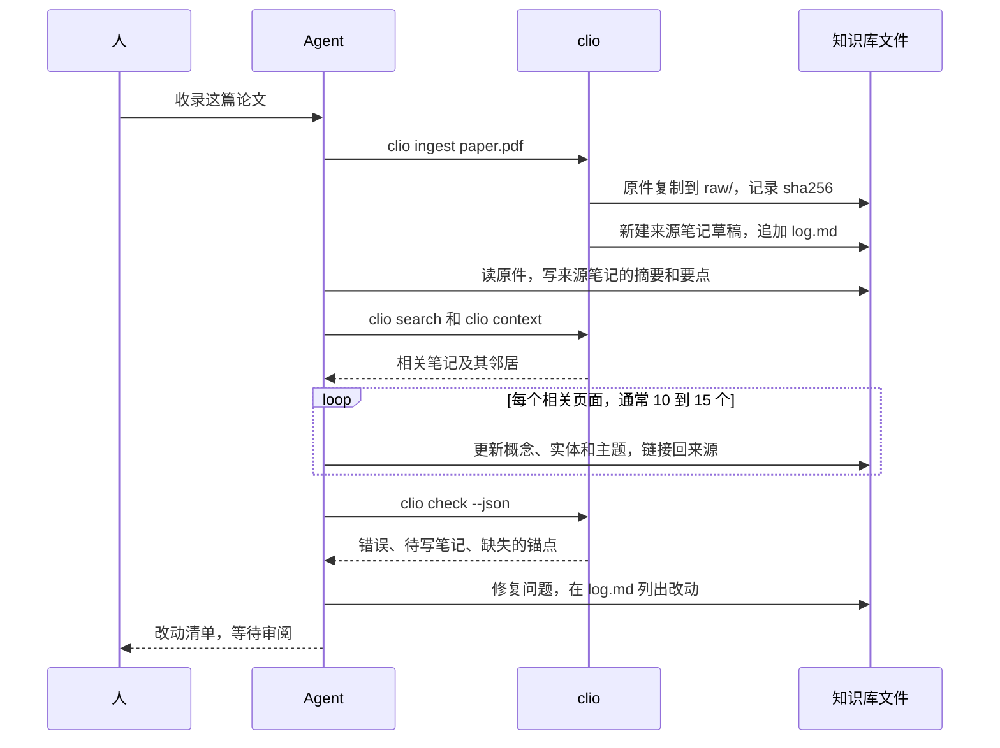

# 与 Agent 协作

Clio 的设计目标是让人和 AI Agent 一起维护同一个知识库：人挑选资料、提出问题、审阅改动，Agent 做整理、交叉引用和检查这些费时的工作。本页说明这套分工从哪里来，Clio 用哪些文件和命令支撑它，以及每个工作流的具体步骤。本页 [[depends-on::vault-layout]]，先了解目录结构会更容易读。

## LLM Wiki 模式

2026 年 4 月，Andrej Karpathy 发表了一份名为「LLM Wiki」的笔记，提出用语言模型维护个人知识库的做法。要点：

- **不在每次提问时从原始资料里现找。** 常见的检索增强（RAG）每次都从原始文档里重新检索、重新理解。LLM Wiki 让模型把读过的资料逐步整理成一个持久的、互相链接的 Markdown 知识库，知识会累积。
- **三层。** 原始资料只读；知识库由模型编写和维护；一份约定文件（如 `CLAUDE.md` 或 `AGENTS.md`）告诉模型知识库的结构和规则。
- **三种操作。** 收录（ingest）：读一份新资料，更新所有相关页面，一份资料通常牵动十到十五个页面；提问（query）：基于知识库回答，好的回答归档成新页面；检查（lint）：定期找出矛盾、过时的结论、孤立页面和缺失的交叉引用。
- **两个特殊文件。** `index.md` 是目录；`log.md` 按时间记录每次操作，只追加。

Clio 把这个模式里的每一部分落到具体的文件和命令上：

| 模式中的部分 | Clio 中的实现 |
|---|---|
| 原始资料，只读 | `raw/`；`clio ingest` 收录并记录 sha256；被改动时 `clio check` 报告 `raw-modified` 错误 |
| 模型维护的知识库 | `notes/` 下按类型存放的笔记，用类型化链接互相连接 |
| 约定文件 | `AGENTS.md`（`CLAUDE.md` 引用它）、`clio.toml`、`templates/` |
| `index.md` | 首页，用查询块按类型生成目录，不需要手工维护 |
| `log.md` | `clio log` 和 `clio ingest` 追加的操作记录 |
| 收录、提问、检查 | Agent Skill 里的工作流，加上 `clio search`、`clio context`、`clio check` 等命令 |
| 在知识库里搜索 | `clio search`（BM25，中英文都支持）和 `clio mcp` |

和原始模式相比有一处不同：Karpathy 的 `index.md` 由模型逐条维护，每条带一句摘要；Clio 把摘要放在每篇笔记的 frontmatter 里，目录由查询生成。笔记增删时目录自动正确，模型少维护一个容易出错的文件。

## Agent Skill

`clio new site` 和 `clio init` 会在项目里安装一个 Agent Skill：`skills/clio/SKILL.md`，按 Agent Skills 格式编写。它告诉 Agent：

- 什么时候用这个 Skill：收录资料、回答关于知识库的问题、维护或翻译笔记；
- 下面四个工作流的每一步；
- 每一步用哪条 `clio` 命令，以及怎样读它们的 `--json` 输出；
- 结束前必须做的检查：`clio check` 没有错误，`log.md` 已追加。

Skill 只写通用的流程。这个知识库特有的约定，例如有哪些自定义类型、用什么语言写标题，写在 `AGENTS.md` 里。不支持 Skill 的工具只读 `AGENTS.md` 也能工作。

## AGENTS.md 是约定层

`AGENTS.md` 是三层里的第 3 层：给 Agent 看的约定。Codex 等工具直接读 `AGENTS.md`；`CLAUDE.md` 里只有一行 `@AGENTS.md`，让 Claude Code 读同一份文件。`clio new site` 生成的版本包含布局、写法和日志规则，可以按自己的需要修改，例如：

```markdown title="AGENTS.md（节选）"
# 知识库约定

## 布局
- raw/ 只读，不要修改或删除其中的文件。
- 每份资料一篇来源笔记，放在 notes/sources/，frontmatter 有 raw 和 sha256。
- 概念放 notes/concepts/，人和组织放 notes/entities/，综述放 notes/topics/。

## 写法
- id 用英文 kebab-case，标题用中文。
- 每篇笔记写一句话 summary：写结论，不写"本文介绍"。
- 引用来源用 [[source::来源id]]，引用具体论断用 [[来源id^块id]]。
- 新结论和旧结论冲突时写 [[contradicts::id]]，不要直接覆盖旧结论。

## 日志
- 每次操作后在 log.md 末尾追加 ## [YYYY-MM-DD] 操作 | 标题，下面列出改动的笔记。

## 检查
- 结束前运行 clio check --json，errors 必须为 0。
```

约定写得越具体，不同的 Agent、不同的会话写出的笔记越一致。约定需要改时，让 Agent 提出修改建议，由人决定是否采纳。

## 收录

收录一份新资料的完整步骤：

:::steps
### 放入原件

```bash
clio ingest ~/Downloads/attention.pdf --title "Attention Is All You Need"
```

原件复制到 `raw/`，记录 sha256；`notes/sources/` 下生成一篇 `draft` 状态的来源笔记；`log.md` 追加一条 `ingest` 记录。

### 写来源笔记

Agent 读原件，在来源笔记里写摘要和要点。每条要点末尾加块 id（`^claim-1`），以便其他笔记精确引用。来源笔记只记录原文说了什么，不加评论。

### 找到相关笔记

```bash
clio search "attention transformer" --json
clio context transformer --hops 2
```

先搜索，再用 `clio context` 读出最相关的笔记和它的邻居，判断哪些页面需要更新。

### 更新相关页面

一份资料通常牵动十到十五个页面：更新已有的概念和实体，为重要的新概念建笔记，在主题笔记里加上新内容。每处新增的结论都链接回来源：`[[source::attention-is-all-you-need]]` 或 `[[attention-is-all-you-need^claim-1]]`。新结论和已有结论冲突时，用 `contradicts` 关系标出来。

### 运行检查

```bash
clio check --json
```

修掉所有错误，处理这次新增的 `wanted` 和 `missing-anchor`：要么写出缺的笔记，要么改正链接。

### 记日志，交给人审阅

在 `log.md` 这次的 `ingest` 记录下面列出新建和更新的笔记，然后把改动交给人审阅，通常是一个 git diff 或一个拉取请求。
:::

一次收录的过程：



## 提问

基于知识库回答问题：

1. `clio search "<问题里的关键词>" --json` 找到候选笔记，先看摘要。
2. 对最相关的一两篇运行 `clio context <id> --hops 2`，读全文和邻居。
3. 回答时链接到依据的笔记，让人能核对。
4. 回答有长期价值时（例如一个比较或一段分析），用 `clio new question "<问题>"` 归档到 `notes/questions/`，链接到依据的笔记，并在相关的主题笔记里加上链接。
5. `clio log query "<问题>"` 记一笔。

第 4 步是这个模式的关键：好的回答不留在聊天记录里，而是回到知识库，下次提问时可以直接用。

## 检查

定期做一次全面检查，例如每周一次：

```bash
clio check --json --all
```

| 发现 | 处理 |
|---|---|
| `wanted` | 被多处链接的，写出这篇笔记；只是随口一提的，去掉链接 |
| `orphan` | 在相关的主题笔记里加链接，或者判断它是否还需要 |
| `stale` | 重读并核对来源，确认无误后更新 `reviewed` |
| `contradicts` 关系 | 读双方的来源，能下结论的写清楚，不能的保留两种说法 |
| `translation-stale` | 见下一节 |

检查也包括引擎发现不了的问题：同一个概念有两篇笔记、摘要和正文不符、该拆分的长笔记。最后 `clio log lint "<概要>"`。

## 翻译

1. `clio translate-status --json` 列出缺失和过期的译文。
2. 逐篇翻译或对照原文的改动更新译文。
3. 把 `translation-of-hash` 改成清单里给出的哈希。
4. `clio check` 确认没有 `translation-stale`。

文件命名和哈希的规则见 [[multilingual]]。

## 给 Agent 的命令

所有只读命令都支持 `--json`，输出的字段名是稳定的。完整的字段说明见 [[cli#JSON 输出]]。

### clio context

把一篇笔记的源文件和它在图谱里的邻居整理成一段 Markdown，直接放进模型的上下文。`--hops 2` 再加上邻居的邻居。

```text
$ clio context vector-search
# 向量检索 (vector-search, concept)

path: notes/concepts/vector-search.md

---
title: 向量检索
…（源文件全文）

## Direct relations

- → depends-on **嵌入** (`embedding`): 把文本映射成向量的模型。

## Wanted (linked but not written yet)

- bm25
```

一次调用就拿到这篇笔记、它直接相关的笔记的摘要，以及还没写的笔记，不需要逐个打开文件。

### clio search --json

```json
[
  {
    "id": "vector-search",
    "title": "向量检索",
    "type": "concept",
    "path": "notes/concepts/vector-search.md",
    "url": "/n/vector-search",
    "score": 3.827,
    "snippet": "把查询和文档都编码成向量，按余弦相似度排序。"
  }
]
```

BM25 全文搜索。中文按相邻两字切分，英文按单词切分，中英混合的查询也能用。

### clio check --json

```json
{
  "summary": { "notes": 2, "files": 2, "edges": 2, "wanted": 2, "clusters": 2, "errors": 0, "warnings": 2, "infos": 1 },
  "diags": [
    { "path": "notes/concepts/vector-search.md", "level": "warning", "line": 12, "code": "wanted", "message": "link to missing note `bm25`" }
  ]
}
```

Agent 按 `code` 决定怎么处理，按 `path` 和 `line` 定位。每个检查码的含义见 [[lint-codes]]。

### clio mcp

在 stdio 上运行 MCP 服务，把 `search`、`show`、`backlinks`、`context` 和 `check` 提供为工具。适合不方便执行命令行的客户端。在 Claude Code 中注册：

```bash
claude mcp add clio -- clio mcp --dir ~/my-kb
```

## log.md

每条记录是一个二级标题，格式固定：

```markdown
## [2026-10-13] ingest | Attention Is All You Need

- 新建 notes/sources/attention-is-all-you-need.md、notes/concepts/self-attention.md
- 更新 transformer、positional-encoding、topics/deep-learning

## [2026-10-13] query | 自注意力的计算复杂度

- 归档为 notes/questions/self-attention-complexity.md
```

标题行由 `clio log <操作> <标题>` 写入，`clio ingest` 自动写一条 `ingest`。常用的操作名是 `ingest`、`query`、`lint`、`edit`。只在末尾追加，不改旧记录：日志是知识库的历史，Agent 开始工作前读最近几条，就知道上次做到哪里：

```bash
grep "^## \[" log.md | tail -5
```
