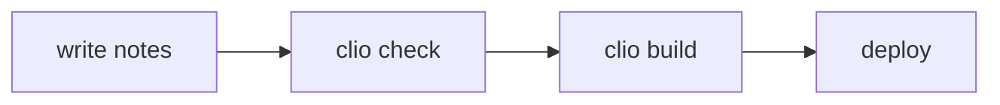

# Rich content

Clio's Markdown is CommonMark plus GFM plus a set of extensions. This page goes through the extensions one by one: first the source, then what that same source renders to on this page. [[syntax-cheatsheet]] has every form on one page.

## Basics

Everything in GFM works: tables, task lists, strikethrough, autolinks, footnotes. Clio adds `==highlight==`, description lists, and emphasis that works next to CJK punctuation: `**加粗**，` is bold without a space outside the asterisks.

````markdown
- [x] A finished task
- [ ] An open task

~~Strikethrough~~, ==highlight==, **bold**, and **加粗**，next to Chinese punctuation. A footnote goes at the end of a sentence[^fn].

[^fn]: Footnotes appear at the bottom of the page.

Term
: The definition follows the colon.
````

- [x] A finished task
- [ ] An open task

~~Strikethrough~~, ==highlight==, **bold**, and **加粗**，next to Chinese punctuation. A footnote goes at the end of a sentence[^fn].

[^fn]: Footnotes appear at the bottom of the page.

Term
: The definition follows the colon.

Inside a table cell, write a pipe as `\|`, including in inline code and in `[[id|text]]` links.

### No raw HTML

HTML tags such as `<div>` and `<script>` are dropped and render as nothing. Some notes come from web pages that agents ingested; because the renderer never passes HTML through, scripts and styles from those pages never reach the site. Use the callouts and directives below for layout.

## Callouts

A blockquote whose first line is `[!type]` becomes a callout, as in Obsidian. The title follows the type.

````markdown
> [!tip] Link first
> Linking to a note that doesn't exist yet is fine; it shows up in the wanted list.

> [!warning]- A folded warning
> A `-` after the type folds it closed; a `+` shows it open but foldable.
````

> [!tip] Link first
> Linking to a note that doesn't exist yet is fine; it shows up in the wanted list.

> [!warning]- A folded warning
> A `-` after the type folds it closed; a `+` shows it open but foldable.

The built-in types; names on the same row are aliases:

| Type | Use |
|---|---|
| `note` | General remarks |
| `abstract`, `summary` | Summaries |
| `info` | Background |
| `todo` | To-dos |
| `tip`, `hint` | Tips |
| `important` | Key points |
| `success` | Success, done |
| `question` | Questions |
| `warning`, `attention` | Warnings |
| `caution` | Caution |
| `failure` | Failures |
| `danger`, `error` | Danger, errors |
| `bug` | Bugs |
| `example` | Examples |
| `quote` | Quotations |

Other names work too, such as `[!decision]`: they render as a callout in the default style, and `clio check --all` gives a `callout-type` notice.

## Directives

A directive starts with a line `:::name`, ends with a line `:::`, and wraps a block of content:

```text
:::name{attributes} Title
Content
:::
```

Rules:

- Attributes go in braces: `{title="Title" .class #id key=value}`.
- To nest, give the outer directive more colons: `::::` outside, `:::` inside. With equal counts, the inner closing line closes the outer directive early.
- The opening line can't contain `:`; reword a title that needs one.
- An unknown name renders its content as a plain block, and `clio check` reports an `unknown-directive` warning.

### Tabs

````markdown
::::tabs
:::tab{title="Global install"}
```bash
bun add -g github:nivalume/Clio
clio build
```
:::
:::tab{title="Project install"}
```bash
bun add github:nivalume/Clio
bunx clio build
```
:::
::::
````

::::tabs
:::tab{title="Global install"}
```bash
bun add -g github:nivalume/Clio
clio build
```
:::
:::tab{title="Project install"}
```bash
bun add github:nivalume/Clio
bunx clio build
```
:::
::::

### Cards

````markdown
::::cards
:::card{title="Notes"}
[[writing-notes]]: fields, types, status and templates.
:::
:::card{title="Links"}
[[linking]]: typed relations, backlinks and wanted notes.
:::
:::card{title="Queries"}
[[queries]]: lists that update themselves.
:::
::::
````

::::cards
:::card{title="Notes"}
[[writing-notes]]: fields, types, status and templates.
:::
:::card{title="Links"}
[[linking]]: typed relations, backlinks and wanted notes.
:::
:::card{title="Queries"}
[[queries]]: lists that update themselves.
:::
::::

### Steps

`steps` styles the ordered list or the `###` headings inside it as numbered steps.

````markdown
:::steps
1. Install Bun 1.2 or later.
2. Run `bun add -g github:nivalume/Clio`.
3. Run `clio new site my-kb`.
:::
````

:::steps
1. Install Bun 1.2 or later.
2. Run `bun add -g github:nivalume/Clio`.
3. Run `clio new site my-kb`.
:::

With `###` headings, each heading and the content under it is one step, which suits tutorials where every step has a code block, such as [[getting-started]].

### Details

````markdown
:::details{title="Why raw/ is read-only"}
Because the originals never change, every claim in the notes can be traced to a fixed version.
:::

:::details{title="Open by default" open}
With the `open` attribute the block starts expanded.
:::
````

:::details{title="Why raw/ is read-only"}
Because the originals never change, every claim in the notes can be traced to a fixed version.
:::

:::details{title="Open by default" open}
With the `open` attribute the block starts expanded.
:::

### Columns

````markdown
::::columns
:::column{width=2}
The wide column. `width` is relative, so this one takes two thirds.
:::
:::column
The narrow column takes one third.
:::
::::
````

::::columns
:::column{width=2}
The wide column. `width` is relative, so this one takes two thirds.
:::
:::column
The narrow column takes one third.
:::
::::

### Admonitions

A callout can also be written as a directive with the same names as callout types. For long content, or content that nests other directives, this is easier than prefixing every line with `>`.

````markdown
:::note An admonition
No `>` needed on each line.
:::

:::warning{title="Folded" fold=closed}
`fold=closed` is the callout's `-`; `fold=open` is its `+`.
:::
````

:::note An admonition
No `>` needed on each line.
:::

:::warning{title="Folded" fold=closed}
`fold=closed` is the callout's `-`; `fold=open` is its `+`.
:::

### Closing lines inside code blocks

A code block inside a directive that contains a `:::` line closes the directive at that line. Give the outer directive more colons:

````markdown
::::details{title="Directive syntax"}
```text
:::note Title
Content
:::
```
::::
````

::::details{title="Directive syntax"}
```text
:::note Title
Content
:::
```
::::

That is also why every source example on this page sits outside the directives.

## Code

A code block's info line names the language, optionally followed by `title="…"` and the lines to highlight:

````markdown
```rust title="src/rank.rs" {2,4-5}
pub fn rank(scores: &[f64]) -> Vec<usize> {
    let mut idx: Vec<usize> = (0..scores.len()).collect();
    idx.sort_by(|&a, &b| scores[b].total_cmp(&scores[a]));
    idx
}
```
````

```rust title="src/rank.rs" {2,4-5}
pub fn rank(scores: &[f64]) -> Vec<usize> {
    let mut idx: Vec<usize> = (0..scores.len()).collect();
    idx.sort_by(|&a, &b| scores[b].total_cmp(&scores[a]));
    idx
}
```

`title` becomes a title bar and `{2,4-5}` highlights lines 2, 4 and 5. Shiki highlights the syntax at build time, once for the light and once for the dark theme, so pages load no highlighting script. The `diff` language shows added and removed lines:

```diff
- stale_days = 180
+ stale_days = 365
```

## Math

`$…$` is inline math and `$$…$$` display math; KaTeX renders both to HTML at build time. Clio uses PageRank to measure how central a note is in the graph. Its formula:

````markdown
The damping factor $d$ is usually $0.85$.

$$
PR(p_i) = \frac{1-d}{N} + d \sum_{p_j \in M(p_i)} \frac{PR(p_j)}{L(p_j)}
$$
````

The damping factor $d$ is usually $0.85$.

$$
PR(p_i) = \frac{1-d}{N} + d \sum_{p_j \in M(p_i)} \frac{PR(p_j)}{L(p_j)}
$$

$N$ is the number of notes, $M(p_i)$ the set of notes linking to $p_i$, and $L(p_j)$ the number of links going out of $p_j$. The graph algorithms are described in [[knowledge-graph]].

## Mermaid

A `mermaid` code block becomes a diagram, rendered in the browser:

````markdown

````


## Charts

A `chart` code block describes data in YAML and is drawn as SVG at build time, so pages need no charting script.

````markdown
```chart
type: line
title: BM25 term-frequency saturation (k1 = 1.2)
x: [0, 1, 2, 3, 4, 5, 10]
series:
  - name: term score
    data: [0, 1.0, 1.375, 1.571, 1.692, 1.774, 1.964]
```
````

```chart
type: line
title: BM25 term-frequency saturation (k1 = 1.2)
x: [0, 1, 2, 3, 4, 5, 10]
series:
  - name: term score
    data: [0, 1.0, 1.375, 1.571, 1.692, 1.774, 1.964]
```

The chart shows how BM25 scores one term as it occurs more often, computed as $tf \cdot (k_1 + 1) / (tf + k_1)$: one occurrence scores 1, ten score less than 2. `clio search` ranks with BM25.

| Key | Value |
|---|---|
| `type` | `bar` or `line` |
| `title` | Chart title |
| `x` | Categories or values on the x axis |
| `series` | List of series, each with a `name` and `data` as long as `x` |

The data can also be CSV with a header row: the first column is the x axis and every other column is a series.

````markdown
```chart
section,pages
guides,10
reference,4
concepts,6
```
````

## Embeds

A paragraph that contains only `![[id]]`, `![[id#Section]]` or `![[id^block]]` embeds that note, section or block in the current page; see [[linking#Embeds]].

Images can be written two ways:

- `![[diagram.png]]` or `![[diagram.png|caption]]`: the image is looked up by file name anywhere in the vault, `raw/` included.
- ``: the standard form, relative to the current file; the image is copied into the site at build time.

Supported formats are png, jpg, jpeg, gif, svg, webp and avif.

## Block ids

End a paragraph or list item with a space and `^block-id`, or put `^block-id` on its own line after a block, and that block can be linked and embedded. Block ids use ASCII letters, digits, `-` and `_`.

````markdown
BM25's term score has a ceiling: each repetition of the same term adds less than the last. ^bm25-saturation

The paragraph above can be linked as [[rich-content^bm25-saturation]].
````

BM25's term score has a ceiling: each repetition of the same term adds less than the last. ^bm25-saturation

The paragraph above can be linked as [[rich-content^bm25-saturation]].

Block ids let notes cite specific claims: a source note gives each key point a block id, and a concept note cites one of them with `[[source-id^block-id]]`, which takes the reader straight to that passage.

## Tags

Write `#tag` or `#tag/subtag` in the body; these merge with the frontmatter `tags`. This sentence, for example, carries the #markdown tag.

How tags are recognised:

- the `#` is at the start of a line or follows a space or punctuation, and the tag name follows immediately;
- the name must contain a non-digit, so `#2024` is not a tag;
- a `#` inside code, links and headings is not a tag.

How to use tags is in [[writing-notes#Tags]].

## Queries

A `clio-query` code block runs at build time and lists the matching notes as a list, table or cards; see [[queries]].
