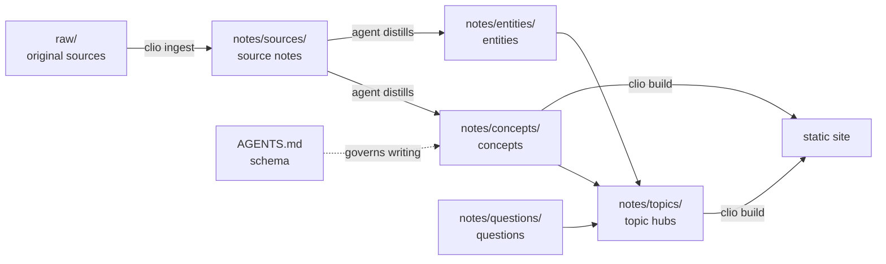

# Vault layout

A Clio vault is an ordinary folder: Markdown files plus a `clio.toml`. You can open it in any editor, keep it in git and browse it in Obsidian. This page explains what each folder created by `clio new site` is for, and why it is split this way.

## Three layers

The structure follows Andrej Karpathy's LLM Wiki pattern (see [[agents]]) and keeps raw sources, notes and conventions in separate layers:

| Layer | Where | What | Who changes it |
|---|---|---|---|
| 1 Raw sources | `raw/` | Originals of articles, papers, web pages, code excerpts, images | Added, never edited; `clio ingest` puts files here |
| 2 Notes | `notes/`, `journal/`, `index.md` | Knowledge distilled from the sources: sources, concepts, entities, topics, questions | People and agents |
| 3 Schema | `AGENTS.md`, `clio.toml`, `templates/` | Which types and relations exist, how to name, link and log | People; agents may propose changes |

The layers make responsibilities clear: the originals can always be checked, the notes can be rewritten at any time, and the schema keeps every rewrite to the same rules.

## Overview

```text
my-kb/
  clio.toml          site, languages, types, relations, build options
  AGENTS.md          layer 3: conventions for agents
  CLAUDE.md          one line: @AGENTS.md
  index.md           home page and catalog; query blocks list notes by type
  log.md             operations log, append-only
  raw/               layer 1: original sources, read-only; clio check verifies sha256
  notes/             layer 2: notes
    sources/         one source note per raw item
    concepts/        concepts: definitions, principles, methods
    entities/        entities: people, organisations, products, projects
    topics/          topics: hubs, overviews, maps of content
    questions/       questions: answers filed back, comparisons
  journal/           optional daily notes
  templates/         one template per type, used by clio new
  theme/             theme.css to override colours and fonts
  skills/clio/       the Agent Skill
  package.json       depends on clio, pins the version
  vercel.json        Vercel deployment config
  .github/workflows/pages.yml    GitHub Pages deployment workflow
  .clio/             build output and cache, not committed
```

## Each folder

### raw/

The original sources. `clio ingest <file or URL>` copies a source here (URLs are downloaded as they are, not converted), computes its sha256 and creates a source note under `notes/sources/` whose frontmatter records where the original is and its hash:

```yaml
raw: raw/attention-is-all-you-need.pdf
sha256: 3f2a9c…e81b
```

Every `clio check` recomputes the hash and reports a `raw-modified` error if the file changed. Because the originals never change, every claim in the notes can be traced back to a fixed version. Files in `raw/` are not read as notes, but images in it can be embedded.

### notes/

The knowledge itself. The subfolders are by note type and set the default type of notes that have no `type:`:

| Folder | Type | What goes there |
|---|---|---|
| `notes/sources/` | `source` | One per raw item: summary, key points, citable blocks |
| `notes/concepts/` | `concept` | One per concept: definition, principle, examples |
| `notes/entities/` | `entity` | People, organisations, products, projects |
| `notes/topics/` | `topic` | Hub notes: an overview of an area, linking to its concepts and sources |
| `notes/questions/` | `question` | Answered questions, comparisons and analyses, filed back into the vault |

A note outside these folders without a `type:` has type `note`. Fields and types are in [[writing-notes]]; adding your own types and folder mappings is in [[customizing]].

### journal/

Optional daily notes, type `journal`. Good for what you read or thought that day; whatever is worth keeping later moves into `notes/`.

### templates/

One template per type, for example `templates/concept.md`. `clio new concept "Title"` creates a note from it, replacing `{{title}}`, `{{id}}`, `{{date}}`, `{{lang}}` and `{{type}}`. There is an example in [[writing-notes#Creating notes with clio new]]. The folder itself is not read as notes.

### theme/

`theme/theme.css` overrides the site's CSS variables, such as colours and fonts; see [[customizing]].

### .clio/

Output of `clio build` and `clio dev` (`.clio/site`) and the cache. It is not committed; delete it whenever you like and the next build recreates it.

### Files at the root

- `clio.toml`: site title, languages, types, relations, folder mapping, ignore list. Every key is in [[config]].
- `AGENTS.md`: the layer 3 conventions, which agents read before they start; see [[agents#AGENTS.md is the schema layer]].
- `CLAUDE.md`: a single line, `@AGENTS.md`. Claude Code reads `CLAUDE.md` and tools such as Codex read `AGENTS.md`, so both see the same conventions.
- `package.json`, `vercel.json`, `.github/workflows/pages.yml`: deployment; see [[deploy]].

## Ids and paths

Every note has an id: the file name without `.md` by default, or `id:` in the frontmatter. Ids are unique across the vault, whatever folder the note is in; two files with the same id give a `duplicate-id` error.

Links refer to ids, not paths, so moving a file never breaks a link. ^ids-stable

That makes reorganising cheap: move a note from `notes/concepts/` to `notes/topics/` and only its default type changes; every link to it keeps working. To change the id itself, use `clio mv <old-id> <new-id>`, which renames the file and rewrites every link to it.

A translation shares the id of its original: `vector-search.md` and `vector-search.en.md` are two language versions of one note; see [[multilingual]].

## index.md and log.md

`index.md` is the home page and the catalog. It doesn't list notes by hand; query blocks list them by type, so new notes show up on their own:

````markdown
## Topics

```clio-query
type = topic SORT title SHOW cards
```

## Recently updated

```clio-query
SORT updated DESC LIMIT 10 SHOW table FIELDS type, updated
```
````

The query language is described in [[queries]].

`log.md` is the operations log. Entries are only appended at the end, never edited. Each entry is a level-2 heading in a fixed format, optionally followed by what changed:

```markdown
## [2026-10-13] ingest | Attention Is All You Need

- created notes/sources/attention-is-all-you-need.md
- updated transformer, self-attention, positional-encoding

## [2026-10-14] query | Transformers versus RNNs

- filed as notes/questions/transformer-vs-rnn.md
```

`clio log <op> <title>` or `clio ingest` writes the heading; the agent adds the list below it. The fixed prefix works with ordinary tools, for example the last five operations:

```bash
grep "^## \[" log.md | tail -5
```

Like `AGENTS.md`, `log.md` is not read as a note and doesn't appear on the site.

## From sources to site



The arrows show how information flows: a source becomes a source note, which is broken down into concepts and entities, which topic notes organise; questions cite these notes and are collected by topics too. `clio build` turns all notes into the site, and the links become the edges of the graph.

## Why folders by type

Folders are by type, never by topic, for four reasons:

- **Types are few and stable; topics are many and change.** A vault has five or six types and they hardly change over years. Topics appear, merge and split as you read. Topic folders would mean moving files at every change.
- **A note belongs to several topics but has one type.** "Vector search" belongs to search and to language-model applications. A file lives in one folder; links can point from anywhere.
- **Topics are expressed with links.** Topic notes curate an area by hand, hierarchical tags (`search/vector`) cut across it, and the engine clusters notes by their links. None of these needs files to move.
- **At scale people search and follow links.** With thousands of notes nobody clicks down a folder tree; the site's home page starts with a search box, then topics and clusters.

The full argument is in [[information-architecture]].

## Ignored paths

These are skipped when reading notes: `.clio`, `.git`, `node_modules`, `.obsidian`, `.trash`, `dist`, `raw`, `templates`, `theme`, `AGENTS.md`, `CLAUDE.md`, `README.md`, `log.md`. Add more under `[build] ignore` in `clio.toml`; see [[config#build]].
