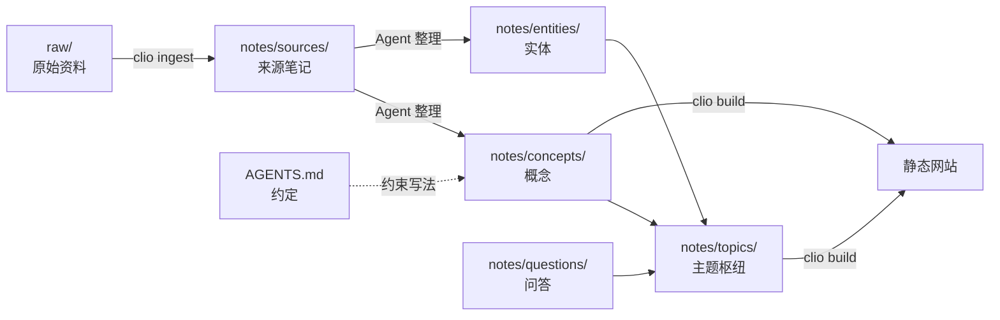

# 目录结构

一个 Clio 知识库就是一个普通文件夹：Markdown 文件加一个 `clio.toml`。可以用任何编辑器打开，用 git 管理，也可以用 Obsidian 浏览。这一页说明 `clio new site` 生成的每个目录做什么，以及为什么这样分。

## 三层

结构沿用 Andrej Karpathy 的 LLM Wiki 模式（见 [[agents]]），把原始资料、笔记和约定分成三层：

| 层 | 位置 | 内容 | 谁来改 |
|---|---|---|---|
| 1 原始资料 | `raw/` | 文章、论文、网页、代码片段、图片的原件 | 只增不改，由 `clio ingest` 放入 |
| 2 笔记 | `notes/`、`journal/`、`index.md` | 从资料整理出的知识：来源、概念、实体、主题、问答 | 人和 Agent |
| 3 约定 | `AGENTS.md`、`clio.toml`、`templates/` | 有哪些类型和关系，怎么命名、链接、记日志 | 人；Agent 可以提议修改 |

分层让责任清楚：原件随时可以回查，笔记可以随时重写，约定保证每次重写都遵守同一套规则。

## 目录一览

```text
my-kb/
  clio.toml          站点、语言、类型、关系、构建选项
  AGENTS.md          第 3 层：写给 Agent 的约定
  CLAUDE.md          只有一行 @AGENTS.md
  index.md           首页和目录，用查询块按类型列出笔记
  log.md             操作日志，只追加
  raw/               第 1 层：原始资料，只读；clio check 校验 sha256
  notes/             第 2 层：笔记
    sources/         每份原始资料一篇来源笔记
    concepts/        概念：定义、原理、方法
    entities/        实体：人、组织、产品、项目
    topics/          主题：枢纽、综述、内容地图
    questions/       问答：回答过的问题、比较
  journal/           可选的日记
  templates/         每种类型一个模板，clio new 使用
  theme/             theme.css，覆盖颜色和字体
  skills/clio/       Agent Skill
  package.json       依赖 clio，固定版本
  vercel.json        Vercel 部署配置
  .github/workflows/pages.yml    GitHub Pages 部署工作流
  .clio/             构建输出和缓存，不进 git
```

## 每个目录

### raw/

原始资料的原件。`clio ingest <文件或网址>` 把资料复制进来（网址原样下载，不做转换），计算 sha256，并在 `notes/sources/` 下新建一篇来源笔记，在 frontmatter 里记下原件的位置和哈希：

```yaml
raw: raw/attention-is-all-you-need.pdf
sha256: 3f2a9c…e81b
```

之后每次 `clio check` 都重新计算哈希，原件被改过时报告 `raw-modified` 错误。原件不变，笔记里的每条结论才能追溯到确定的版本。`raw/` 不作为笔记读取，但其中的图片可以嵌入笔记。

### notes/

知识本身。子目录按笔记类型划分，决定没写 `type:` 的笔记的默认类型：

| 目录 | 类型 | 放什么 |
|---|---|---|
| `notes/sources/` | `source` 来源 | 每份原始资料一篇：摘要、要点、可引用的块 |
| `notes/concepts/` | `concept` 概念 | 一个概念一篇：定义、原理、例子 |
| `notes/entities/` | `entity` 实体 | 人、组织、产品、项目 |
| `notes/topics/` | `topic` 主题 | 枢纽笔记：综述一个领域，链接到相关的概念和来源 |
| `notes/questions/` | `question` 问答 | 回答过的问题、比较、分析，归档回知识库 |

不在这些目录里、也没写 `type:` 的笔记，类型是 `note`。字段和类型见 [[writing-notes]]，增加自己的类型和目录映射见 [[customizing]]。

### journal/

可选的日记，类型是 `journal`。适合记当天读了什么、想了什么；值得长期保存的内容再整理进 `notes/`。

### templates/

每种类型一个模板，例如 `templates/concept.md`。`clio new concept "标题"` 用它生成新笔记，替换其中的 `{{title}}`、`{{id}}`、`{{date}}`、`{{lang}}`、`{{type}}`。模板示例见 [[writing-notes#用 clio new 创建]]。`templates/` 本身不作为笔记读取。

### theme/

`theme/theme.css` 覆盖网站的 CSS 变量，例如颜色和字体，见 [[customizing]]。

### .clio/

`clio build` 和 `clio dev` 的输出（`.clio/site`）和缓存。它不进 git，删掉也没关系，下次构建会重新生成。

### 根目录的文件

- `clio.toml`：站点标题、语言、类型、关系、目录映射、忽略列表。全部键见 [[config]]。
- `AGENTS.md`：第 3 层约定，Agent 每次工作前先读它，见 [[agents#AGENTS.md 是约定层]]。
- `CLAUDE.md`：只有一行 `@AGENTS.md`。Claude Code 读 `CLAUDE.md`，Codex 等工具读 `AGENTS.md`，这样它们看到的是同一份约定。
- `package.json`、`vercel.json`、`.github/workflows/pages.yml`：部署用，见 [[deploy]]。

## id 与路径

每篇笔记有一个 id，默认是文件名去掉 `.md`，也可以在 frontmatter 里用 `id:` 指定。id 在整个知识库里唯一，与笔记在哪个目录无关；两个文件用了同一个 id 时报告 `duplicate-id` 错误。

链接写的是 id，不是路径，所以移动文件不会破坏链接。 ^ids-stable

因此整理目录的代价很低：把一篇笔记从 `notes/concepts/` 挪到 `notes/topics/`，只改变它的默认类型，所有指向它的链接照常工作。要改 id 本身时用 `clio mv <旧 id> <新 id>`，它会重命名文件并改写所有指向它的链接。

翻译和原文共用 id：`vector-search.md` 和 `vector-search.en.md` 是同一篇笔记的两个语言版本，见 [[multilingual]]。

## index.md 与 log.md

`index.md` 是首页，也是目录。它不手写笔记列表，而是用查询块按类型列出，新增的笔记会自动出现：

````markdown
## 主题

```clio-query
type = topic SORT title SHOW cards
```

## 最近更新

```clio-query
SORT updated DESC LIMIT 10 SHOW table FIELDS type, updated
```
````

查询语言见 [[queries]]。

`log.md` 是操作日志，只在末尾追加，不改旧记录。每条记录是一个格式固定的二级标题，下面可以列出这次改了什么：

```markdown
## [2026-10-13] ingest | Attention Is All You Need

- 新建 notes/sources/attention-is-all-you-need.md
- 更新 transformer、self-attention、positional-encoding

## [2026-10-14] query | Transformer 与 RNN 的比较

- 归档为 notes/questions/transformer-vs-rnn.md
```

标题行由 `clio log <操作> <标题>` 或 `clio ingest` 写入，下面的列表由 Agent 补充。前缀固定，用普通工具就能查看，例如最近五次操作：

```bash
grep "^## \[" log.md | tail -5
```

`log.md` 和 `AGENTS.md` 一样不作为笔记读取，不出现在网站上。

## 从资料到网站



箭头是信息的流向：资料先变成来源笔记，再拆成概念和实体，由主题笔记组织起来；问答引用这些笔记，也被主题收录。`clio build` 把所有笔记一起变成网站，链接成为图谱的边。

## 为什么按类型分目录

目录只按类型分，不按主题分，原因有四个：

- **类型少而稳定，主题多而易变。** 一个知识库只有五六种类型，用几年也不怎么变；主题随着阅读不断出现、合并、拆分。按主题建目录，每次调整都要移动文件。
- **一篇笔记属于多个主题，但只有一种类型。** 「向量检索」既属于搜索，也属于语言模型应用。文件只能放在一个目录里，链接可以指向任意多处。
- **主题用链接表达。** 主题笔记手工组织一个领域，层级标签（`search/vector`）提供交叉分类，引擎还按链接结构自动聚类。三者都不需要移动文件。
- **规模大了以后靠搜索和链接找东西。** 有几千篇笔记时，没人逐层点开目录树；网站首页先是搜索框，其次是主题和聚类。

完整的论证见 [[information-architecture]]。

## 忽略的路径

读取笔记时跳过：`.clio`、`.git`、`node_modules`、`.obsidian`、`.trash`、`dist`、`raw`、`templates`、`theme`、`AGENTS.md`、`CLAUDE.md`、`README.md`、`log.md`。在 `clio.toml` 的 `[build] ignore` 里可以追加，见 [[config#build]]。
